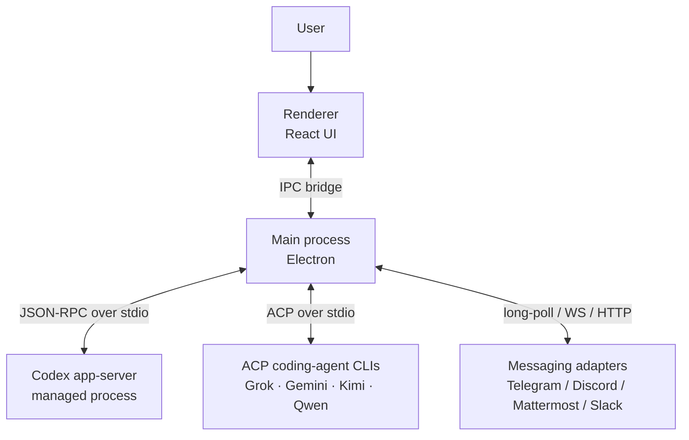
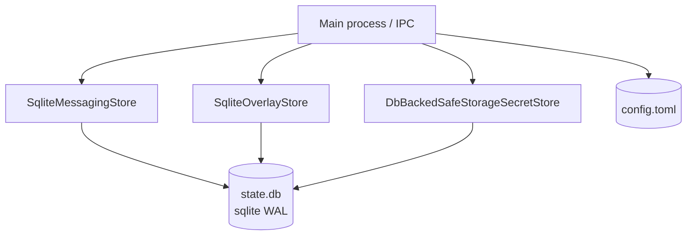
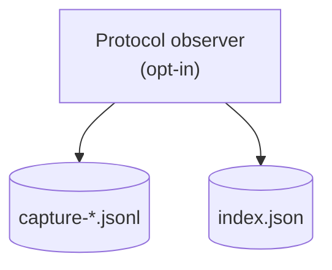
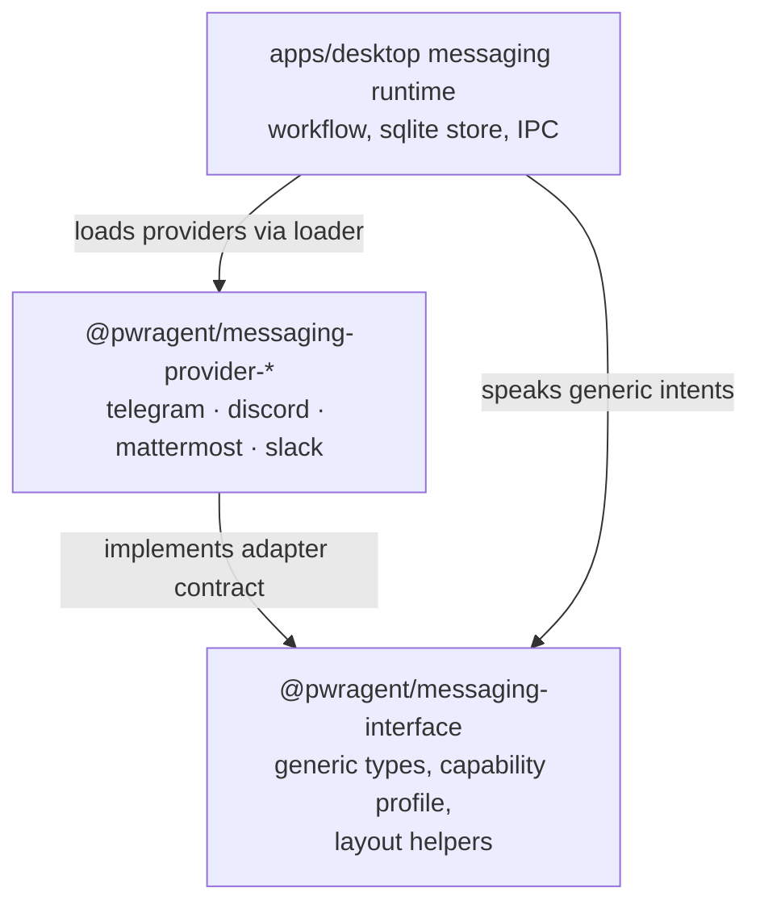
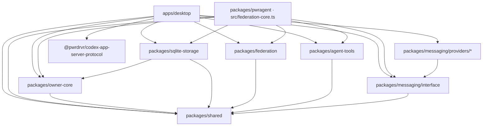

# Architecture

This document is the engineer's first pass through PwrAgent. It covers the
process model, where data lives, how messaging is layered, and the
dependency rules that keep the codebase navigable. For the user-facing
pitch, see [README.md](README.md). For day-to-day development setup, see
[CONTRIBUTING.md](CONTRIBUTING.md).

## Process model

PwrAgent is an Electron app whose coding-agent runtimes execute outside
Electron main. The renderer (React UI) talks to the main process over the
standard Electron IPC bridge. Electron main connects to Codex App Server and
to installed ACP coding-agent CLIs, including Grok Build.

A few invariants worth knowing up front:

- The renderer may only import `@pwragent/shared` from the workspace.
  Everything else is gated behind IPC.
- Coding-agent stdout is protocol-only. Child diagnostics go to stderr so
  they cannot corrupt Codex or ACP framing.
- One messaging adapter, one controller, one capability profile. See
  [Messaging layer](#messaging-layer) below.

Codex authentication remains Codex-owned. ACP agent authentication and
conversation storage remain owned by the installed CLI. PwrAgent persists the
session metadata and desktop overlay state needed to locate and present those
threads without duplicating full provider transcripts in sqlite.

Codex configuration overlays are process-local arguments on the profile's
single App Server connection. `models.codex.config_overrides` in PwrAgent TOML
maps to `models.codex.configOverrides` in settings patches/projections; the
settings resolver supplies its ordered `key=value` strings to
`buildCodexClientArgs` as individual `-c` arguments. Codex owns value parsing and
config precedence. PwrAgent validates the envelope and reserves its approval,
sandbox-mode, PATH and CODEX_HOME launch keys (including parent-table writes).
No overlay is written to the selected Codex home. Existing per-thread protocol
settings still override process defaults; overlays do not migrate saved thread
model selections or add model capability metadata.

Ephemeral Codex helpers share that App Server with interactive threads. Title
and structured-object generation (including data-only Token Miser helpers) and
Star Map intake compose their existing `thread/start.config` with
`features.hooks = false` and `notify = []` on both primary and legacy attempts.
The composer preserves the rest of each feature table and the helper's MCP and
execution restrictions. Ordinary start, resume, and fork requests retain their
configured hooks and notifications, including user-facing Agent/manager threads
and automation coding threads. Helper policy is scoped to the helper request.

Overlay changes enter the existing provider fingerprint/invalidation path and
reconnect Codex at an idle boundary, then resolve the current overlay again.
Invalid edits retain the config store's last-known-good snapshot; a cold start
with invalid config and no such snapshot cannot launch Codex using defaults.
The setting is additive, so there is no legacy field to migrate or dual-write.
Clearing it with an empty array restores ordinary launch arguments. Overrides
are plaintext configuration, including in process arguments; provider secrets
belong in environment variables referenced by Codex's `env_key` or
`env_http_headers`. No new periodic or per-turn persistence is introduced.

## Git information reads

Navigation Git information goes through main-process stores. Directory enrichment
is owned by `main/git-info/directory-store.ts`, shared by production Codex clients.
Its filesystem observation and Git subprocess implementation live under
`git-info/private/`; dependency-cruiser rejects imports of those probes from
outside the store layer. Renderer imports of main-process implementations,
`child_process`, Dugite, simple-git, and isomorphic-git are forbidden too.

`GitReadCache` owns admission before any I/O. Directory enrichment reuses confirmed
results for one second and negative or unconfirmed results for five seconds.
After that window, filesystem identity decides whether Git needs to run. External
branch changes therefore become visible on the next admitted read; missing paths
and failed probes retry after the negative window. No watcher or timer is required.
`GitDirectoryService` and `GitWorkingStateService` use the same admission primitive
for their status reads, retaining their three-second default freshness windows.

Callers may report `userAction`, but cannot demand a bypass by deleting cached
status. The stores share one process-wide allowance of ten user refreshes,
refilling at one per second on a monotonic clock. In-flight reads coalesce before
spending a token. An exhausted allowance falls back to normal cache freshness;
cold or expired entries still load normally. Errors identify the caller and path,
rate-limited to one log per ten seconds with suppressed denials counted. Actual
mutation events may invalidate affected working state. Admission state is entirely
in memory and adds no SQLite writes.

An admitted user refresh also refreshes branch/worktree inventory beneath the
directory status cache. Automatic forced scheduling carries no user intent and
does not spend the user allowance.

## Thread state and lifecycle

### Runtime and refresh

- Navigation snapshots own thread summaries, ordering, unread state, and
  selection metadata.
- Selected-thread session state owns transcript history, active-turn state,
  approvals, and lazy skill state.
- Active selected threads consume thread events incrementally instead of
  rereading complete transcripts after each event.
- Cached inactive threads use summary freshness before full transcript
  hydration.
- Electron main normalizes provider events into stable transcript contracts
  before the renderer consumes them.
- Plan updates are first-class transcript entries rendered inline in
  conversation chronology.
- Questionnaire requests keep separate renderer state and return
  protocol-shaped answer maps.
- Thread history archival and worktree snapshot archival use distinct APIs and
  provider-specific restore paths.

### Archived worktree removal admission

Each cleanup queue batch builds one fleet index
(`apps/desktop/src/main/app-server/archive-cleanup-fleet-index.ts`) from one
complete read of active and archived identities and overlays across Codex,
Claude and ACP, without Git enrichment. Within the batch, every writer and
notification that already fences removal marks the identity it changed, and
only that identity is read again: Codex `thread/read`, the ACP session, the
Claude store and its overlay. A change that names no identity, or more changed
identities than a quarter of the fleet, requests another complete read. Marks
carry epochs, so a read that began before a newer change cannot settle it.

The index maps canonical paths to identities. Discovery and admission for a
checkout see only identities whose workspace is the checkout, inside it or
above it, plus every identity whose workspace or external marker cannot be
resolved, and only the paths of each that relate. Within a batch, preliminary
discovery for one checkout is shared until a row it covers changes or a row is
written near it. Otherwise scoped Git observations stay job-local. Broad repair
discovers candidates across all archived workspaces with one complete,
uncached read, then processes that candidate list through queued removals.
Adapters without paged archive discovery keep their aggregate read contract.
The fleet index is the only inventory shared within a batch.

Removal admission never uses preliminary evidence. Before each removal it
reads the Codex rows changed since the index's watermark, newest `updated_at`
first, five rows a page for at most twenty pages. It rereads the overlay of
every related identity. It compares two change tokens for writers outside this
process: SQLite `PRAGMA data_version` for the overlay store, and the Claude
session directory's inode and timestamps. It reads the complete fleet again
when a token moved, when the provider cannot order by `updated_at`, when the
changed rows exceed the pages, or when a path-scoped workspace write touched
the checkout. Archived siblings that share the checkout are resolved here,
while it exists; after removal a symlink to it dangles. The reservation, the
lifecycle fences and the assertions before `git worktree remove` are unchanged.

What the reservation serializes, and what it cannot:

- PwrAgent's own writers (`withArchiveWorkspaceWrite`,
  `withThreadWorkspaceMutation`, `withThreadLifecycleMutation`) register before
  their first await. A reserved removal refuses an intersecting controlled
  write; an observed change revokes the admission, and the final assertion
  keeps the checkout.
- A provider notification revokes an admission for its identity, but one that
  arrives after the final assertion cannot stop `git worktree remove`.
- A Codex thread another client starts in, or moves into, the checkout without
  notifying this process is seen only if it advanced `updated_at` before the
  admission's recency read. External `thread/unarchive` also advances it:
  protocol-only captures on 2026-11-05 with Codex 0.160.0 and 0.163.0 confirmed
  visibility from another App Server's `thread/list` with
  `sortKey: "updated_at"` and `useStateDbOnly: true`, both before and after
  restarting the restoring client. `thread/resume` by ID or archived path and
  `thread/fork` reject archived threads instead of reactivating them. Another
  process's overlay or Claude-session write is seen only if it committed
  before the token comparison.
- Not seen within a batch: a symlink retargeted after the batch's complete
  read, and direct filesystem or Git use of the checkout by something that is not a
  thread. The archive service still rechecks Git's lock immediately before
  removal. An unreported provider removal keeps the checkout protected until
  the next batch reads the fleet.

Archive snapshot preparation and the final lock recheck resolve only the
target's Git admin directory. The checkout's `.git` file, the admin entry's
`gitdir` backlink and `commondir` must agree with the supplied repository;
the common directory itself is refused as a primary checkout. Neither check
lists sibling worktrees. The final check stays inside terminal teardown and
before Windows link cleanup. `worktree-archive-git.property.test.ts` measures
the real Git boundary while archiving 201 checkouts and uses Git as the
registration, branch and snapshot oracle across layouts and late mutations.

Only one physical cleanup runs at a time. A bulk archive beyond the queue's 256
slots waits as an intent and is admitted as slots free; quit checkpoints it.
Waiting references are indexed by blocker, checkout and supplied path, so a
release or a freed slot touches only its rows. The checkpoint stores one SQLite
row per intent and writes only rows that changed. A reference boundary writes
only when references were added, since recovery rereads every recovered row.
Quit always writes. These checks add no timer and no idle SQLite write. Exact
read and write budgets for archive-all of 1,000, 50 of 1,500, multiple
worktrees per thread, shared canonical checkouts and 300 released checkouts live
in `archive-cleanup-scaling.test.ts` and `archive-cleanup-scaling-budgets.json`.
The generated ownership, reference, restart and snapshot model lives in
`archive-cleanup-fleet.property.test.ts`; the index's oracle in
`archive-cleanup-fleet-index.property.test.ts`; adversarial interleavings in
`archive-cleanup-fleet.test.ts`. Earlier provider, pipeline and discovery suites
(`archive-cleanup-provider.test.ts`, `archive-cleanup-pipeline.test.ts`,
`archive-cleanup-discovery.property.test.ts`) still apply.

### Display reads and federation

- Native navigation pages, selected detail, queue projections and launchpad
  configuration use the same registered `backend.*` handlers and capability
  table as remote viewers. The in-process transport gives the local operator
  every capability without starting federation or acquiring its profile lease.
  IPC still owns window consumer cancellation and Attention view lifetimes.
  Only transport-owned local context admits viewer inventory; a remote request
  cannot read this machine's viewer inventory by claiming that context in its
  payload. Both paths retain the navigation pool's response byte budgets.
- Desktop transcripts use `readThread` with `display.resource = "transcript"`.
  The owning main process prepares completed-turn usage activities and compact
  pricing totals. It sends each transcript message once in `replay.entries`;
  the renderer derives its message list from those entries. Historical pricing
  lines, tool invocations, Code Mode observations, and duplicate last-message
  fields are absent from this response.
- Pricing, tool-call, and sub-agent panels request their own display resource
  when opened. Pages contain up to 50 top-level rows (20 by default), with
  totals computed over the complete owner history. Sub-agent categories have
  independent pages and counts over their full history. Cursors are tied to a
  resource revision. A stale cursor requires a refresh; an open panel refreshes
  the number of pages the operator has already requested.
- A pricing row includes its displayed gate children and decision details.
  Transcript text and expanded panel details retain their content; a row-count
  limit is not a hard byte limit on an individual message or row.
- Pricing, tool-accounting, and sub-agent events invalidate display resources
  instead of pushing their complete histories. Spend and tool alerts retain
  their notification data. Loaded transcript turns request owner-prepared
  usage corrections through the `accounting` resource, without replaying the
  transcript. Inspection tools and the Tool Output Incident Explorer explicitly
  request accounting data through ordinary reads.
- Remote transcripts with event-subscription permission use the sequenced
  stream and catch up after stream acknowledgement or reconnection. Peers
  granting only thread-detail reads retain navigation-timestamp and idle-status
  snapshot recovery.
- These projections apply before both local renderer IPC and federation event
  delivery. Federation payload reduction comes from resource selection and
  projection; the transport does not compress the payload.

### Configuration and identity

- New chats remain launchpad state until first send, so provider selection
  stays editable before thread creation.
- After creation, backend identity is fixed to the thread.
- Model, reasoning, service-tier, and fast-mode defaults are persisted per
  thread for later turns.
- Composer controls render only capabilities advertised by the selected
  backend and model.
- Thread identity is the backend plus thread identifier.
- Thread titles expose explicit, derived, and fallback sources as distinct
  states.
- Explicit names prevent generated titles from replacing operator intent.

Thread naming lifecycle lives in `owner-core/thread-naming-lifecycle.ts`.
It serializes renames by backend and thread id, checks conditional renames
against the current provider name, and owns placeholder eligibility and active
title attempts. A successful explicit rename retains the owner's intent even
when its text matches the first prompt. Generated titles recheck eligibility
inside that same queue. Desktop supplies provider effects, Agent metadata
storage, cache invalidation and event delivery through host ports; the existing
provider storage sites and notification ordering stay with those effects.

Helper-title admission and completion live in
`owner-core/thread-title-lifecycle.ts`. It consumes prepared turn input from
lifecycle confirmation, admits one helper attempt per backend/thread identity,
and coordinates helper results through the naming lifecycle. Desktop supplies
helper execution, model resolution, diagnostics and the existing sub-agent and
usage persistence effects. Completion waits for all admitted work, including
work admitted by a preceding title event.

Outpost now supplies the same title lifecycle with its existing Codex client's
structured title helper. The accepted first-turn event retains the immediate
prompt fallback and admits one helper attempt; duplicate observations do not
run it again. The naming lifecycle protects explicit renames while a helper is
pending. The client selects an offered helper model, uses an ephemeral scratch
thread with hooks, notifications, project instructions and MCP tools disabled,
and cleans it up without adding it to job or navigation inventories. Outpost's
host policy explicitly sets approval `never` and read-only sandboxing on both
primary and legacy helper creation and on its turn. Shutdown settles admitted
title work before closing owner storage. Unsupported providers gain no execution.

Outpost's real job turn path also uses shared turn-start admission after native
thread preparation, rechecking a handoff lock before inference. Its durable job
acceptance, fingerprint and confirmed thread/turn outcomes remain host effects;
the lifecycle adds no retry identity or replay after restart.

Both Outpost native creation paths now use `ThreadCreationLifecycle`. The
federation host records positive native membership before attempting canonical
metadata, so a failed host finalizer retains the provider identity and cannot
hide acceptance. Actual job turns use `ThreadTurnStartLifecycle.submitCodex`
and `finalizeCodex`; durable job confirmation precedes independent title/event
finalization. Observer and diagnostic failures cannot undo a committed job or
replace a provider outcome. A refused confirmed-turn write records the known
thread/turn identity as unknown through the existing terminal boundary, without
resending provider input. A terminal arriving during finalization retires the
job once. Hosts omit unsupported effect ports; desktop retains its complete
typed host contracts and existing construction. No extra tools or reach result.

Steer-request admission lives in `owner-core/thread-steering-lifecycle.ts`.
It qualifies request ids by backend, thread and expected turn, fences changed
input/origin/delivery, and shares completion across concurrent retries. Provider
rejection permits another submission; an accepted provider result survives a
host completion failure so retry repeats only that completion. Provider terminal
events retire that turn's admissions. Desktop supplies provider execution and
causal-origin merging/persistence through host ports, retaining their existing
locks, storage sites and event order. The core does not infer active turns.

Outpost uses this same admission and submission path for federation steering
and active-turn steering. Its host resolves the latest active job, rechecks
handoff locks before native submission, and retains authenticated causal origin
only after provider acceptance. Retention reads the captured job again, preserving
concurrent terminal outcomes and other accepted origins. Failed retention retries
only that effect. Legacy peers without a request id retain independent sends.
Runtime interruption uses the shared interruption coordinator while keeping its
durable interrupting/RPC/restoration boundaries; it does not retire steering
admission until the provider terminal. Sparse ports omit unsupported provider,
review, attachment and restart effects; desktop retains its complete contracts.

Interruption target coordination lives in
`owner-core/thread-interruption-lifecycle.ts`. It resolves the reviewer that
owns a visible parent turn before dispatching to a provider, including reviews
of Claude parents, and applies the host's native-review interrupt alias. Review
interrupts return the parent's identity and retain ownership until the provider
terminal event. Desktop supplies MCP cancellation, provider execution, ACP
prompt locking, runtime selection, logging and active-mode retirement through
host ports. Active-turn identity maps and persistence remain host-owned.

The production turn queue lives in `owner-core/thread-turn-queue.ts`.
Desktop's `BackendRegistry` constructs that class directly with its existing
start, steer, occupancy, restart-gate and lifecycle callbacks. The shared queue
owns FIFO admission, independent hold causes and revisions, paused entries,
grouped messages, early/duplicate terminals and dispatch suspension. Desktop
still owns provider/resource construction, durable project holds and restart
continuations, title generation, correspondence and event delivery. Closing
the queue cancels its pending drains at the same registry shutdown boundary.
The generated queue model runs against this shared implementation; desktop's
restart-gate model and actual registry construction/projection oracle exercise
its host wiring. Outpost's executable Runtime also constructs that class
directly. Continued-thread jobs commit acceptance before entering its FIFO;
the host supplies the existing turn lifecycle, one daemon-global provider
slot, handoff/intake gates and typed queue events/projections. Prompts stay in
memory. Cancellation settles the job before dispatch, and shutdown or recovery
settles unfinished queued jobs as unknown without restoring or replaying input.
New-thread jobs still require an idle host. Confirmed provider acceptance cannot
return to a retryable FIFO after a host confirmation failure.
The queue also retains that acceptance when its started lifecycle publication
rejects. Buffered native terminals still settle ownership and install failure
holds; observer failures cannot restore accepted start or steering input.
Ordinary authenticated agent messages without requested settings or explicit
`new_turn` delivery use the same queue's individual `submitSteer` admission on
Outpost. Each accepted job retains its own input and delivery fingerprint;
accepted messages are never concatenated. At the FIFO head it joins the current
native turn, or starts a new turn when idle. The existing steering lifecycle
receives that job's exact request identity and captured native target. A durable
starting claim precedes inference; the daemon-global dispatch slot stays held
through acknowledgement and origin finalization. The original active job keeps
control ownership. Provider terminals settle the accepted interjections against
that same turn; uncertainty, shutdown and recovery never restore their input.
CLI interruption also requires that original active job; an interjection's
confirmed target does not grant it native control. Shutdown drains restored
entries again after admitted dispatch settles, including a refused claim.
Explicit new turns, requested settings and durable turn receipts retain ordinary
turn admission. Delivery metadata uses the existing job payload, without a schema
change, and is part of each fresh immutable fingerprint.
Explicit Retry also admits held, unclaimed individual guidance into a confirmed
running native turn when that same
steering path is eligible. It rechecks live owner/project/handoff gates and
immutable acceptance before claiming the captured target; occupied dispatch,
uncertainty and shutdown still refuse it. Shared release preserves review
holds behind a dispatch gate and cannot start work after queue close. The
original job retains native control; accepted or uncertain guidance never
returns to the waiting FIFO.
The composer permits owner-backed Retry during a live turn and retains the
waiting row unless the owner reports acceptance. Scheduled Retry still waits
for the active turn to finish.
Outpost's registered pause/resume and ordering methods delegate to the same
queue operations desktop uses. Pause revisions and independent review holds
remain in that engine; typed state/order events invalidate the owner projection.
Local CLI controls use those same runtime methods. The changes stay in memory,
make no SQLite commits and cannot change accepted input or its fingerprint.
Desktop pause publication rereads the shared FIFO after the mutation settles.
A cancelled row emits no later pause update; a replaced row publishes its current
hold and pause revision. The response still acknowledges the original mutation.
Cleanup of a sent project wake-up's durable hold follows the completed pause,
even if a concurrent Resume is already live. Once paused, that ordinary waiting
message cannot return as a project hold after restart.
Outpost also serves the existing queued-input read through the shared
`thread_detail` capability. It returns a detached input/origin snapshot and its
content hash, including for editing. The existing viewer Edit flow cancels that
hash before restoring a viewer-local draft; changed input gets a new acceptance
identity. Reading never reserves or releases the FIFO and adds no persistence.

Desktop sender replacement also cancels the waiting identity before fresh
admission through that queue. Serialized controls recheck the live sender and
position; grouped contributions from other senders, independent holds and pause
revisions stay intact. An untouched grouped contribution retains its sender's
replacement handle until that contribution leaves or is replaced; retired queue
identities still refuse reads and controls. The sender retains its cancelled
correspondence input and initializes the replacement receipt before recipient
admission, so early lifecycle outcomes survive the response. A durable new-turn
receipt remains attached to its cancelled original identity, and cannot replay
or retarget changed input.

Desktop and Outpost construct the same `DurableTurnRequestService` from
owner-core for durable turn admission. The profile binding supplies the existing
FULL/immediate inbox storage port. Authenticated issuer/device namespaces and
owner-bound payload hashes precede dispatch. Outpost assigns one safe immutable
identity to the receipt, durable job, live queue and events, then calls its
existing turn path. Both the durable feature grant and `turn_control` are
required; nested messaging origins retain their additional grant and origin
authentication. Proven queue boundaries reconcile receipts. Shutdown or a
missing live queue yields uncertainty without restoring input or reclaiming a
dispatch claim. Changing accepted input requires cancellation and a new UUID.

Outpost also registers the existing durable steering methods on that same inbox.
Both `turn_control` and `durable_steer_requests_v1` are required. Its host port
calls the existing active-turn control method, using the receipt identity as the
steer request id and the caller's expected native turn as the target. The receipt
acknowledges acceptance of the interjection, independently of eventual turn output;
it creates no job or FIFO entry and cannot displace waiting input. Issuer/device
and start/steer namespaces remain separate. Native or result-persistence uncertainty
retains the durable claim across retries and restart without sending again.

Steer submission lives in `owner-core/thread-steer-submission-lifecycle.ts`.
It owns delivery refusal, restart-gate queue admission, native-review admission,
provider selection and response/effect sequencing. The existing steering
lifecycle records provider acceptance before Claude origin persistence or Codex
attachment retention. Failed host effects remain pending on that acceptance;
retries share their completion and never resend the accepted provider input.
Successful retention is not repeated if later causal-origin completion fails.
Desktop supplies attachment preparation, provider calls, ACP prompt locking,
pending-message context and persistence at their existing lifecycle sites.

Turn-start admission and optimistic Codex preparation live in
`owner-core/thread-turn-start-lifecycle.ts`. Pending starts are counted by
backend/thread before lifecycle mutation admission, so handoff, archive and
live-event checks see starts that are still waiting. The lifecycle checks the
current lock after admission, wakes the workspace, and releases each count
when that start settles. Codex preparation owns the synthetic start identity
and ordered input/context/title admission. Context staging finishes before
the optimistic start, so a rejection announces no turn and needs no synthetic
terminal persistence. Later announcement failures clean up the staged context;
reservation retirement still runs if terminal delivery fails. Desktop retains provider active-turn maps,
model/runtime/MCP/input preparation, workspace effects, notifications and
persistence through host ports. The shared lifecycle also coordinates Codex
submission failure retirement, optional recovery, and backend-qualified response
identity resolution from provider events. Retirement and retry disposal run even
if failure notification rejects. Synthetic start/failure share an observation
sequence, so a newer provider status retains authority through failure and
navigation projection. Accepted Codex finalization also lives in this lifecycle:
it binds origin/context/attachments and retry identity, hands over provider
ownership, selects model/execution persistence, and schedules replay and titles
in their established order. A rejected host effect is reported by stage and
does not reject the accepted provider response or prevent independent later
effects. Origin disposal and handover still run, with terminal ownership read
after origin persistence yields. This adds no request identity or retry state.
Provider calls, repair execution/registry, logging, attachment handling and all
persistence remain host effects at their existing lifecycle sites.

ACP turn starts use the same lifecycle for reservation, preparation, context
staging and submission. Once the provider accepts, origin binding, managed-review
context consumption, PDF/title/context coordination, origin persistence and
attachment retention run in their established order. Independent host failures
are reported without rejecting that accepted identity. Context/origin disposal
and reservation release are attempted independently on both acceptance and
rejection. The host retains ACP prompt locks, provider active-turn ownership,
runtime/model/environment setup and every existing storage site. This adds no
request identity, retry state or persistence.

Claude turn starts use the lifecycle for preparation-to-session grant ownership,
accepted origin binding/persistence and origin disposal. Before provider invocation,
failed preparation releases its MCP grants. Claude's existing session-close contract
consumes release on every invocation, including refusal while a session is live;
only that callback then revokes grants, once. Later origin or cleanup failures are
reported without replacing the provider outcome. Desktop retains Claude execution,
runtime/model/environment/MCP/input setup, active sessions and every storage site.

Thread creation acceptance and finalization live in
`owner-core/thread-creation-lifecycle.ts`. It selects the provider, limits
connection revocation and workspace rollback to rejected creation, and hands
accepted identities to binding, pending navigation, metadata, visibility and
notification ports in the established order. Independent finalization failures
are reported without rejecting a thread its provider already created. Parent
notification follows a successful relationship write; visibility uses that saved
relationship even if its notification fails. Codex owns its start event. Desktop
retains workspace/environment/model/MCP preparation, provider execution, pending
summary construction and all existing storage sites. No request identity or
retry state is introduced.

Creation preparation uses that lifecycle's invocation-local resource scope.
It owns the prepared workspace rollback and acquired connection grants until
provider creation takes ownership. A preparation refusal drains every admitted
branch, including work admitted before a synchronous host failure, then revokes
all acquired grants before rolling back the workspace once. Cleanup and reporting
failures do not replace the preparation refusal. Provider rejection uses the
existing creation cleanup; accepted threads retain their resources. Runtime,
environment, model and MCP construction remain desktop host effects. This
coordination adds no persistence.

### Transcript invariants

- Transcript order is canonical before grouping, collapsing, hydration, or
  role presentation.
- Observed live sequence outranks coarse hydrated timestamps when transcript
  entries merge.
- Grouping may contain only adjacent entries and may not cross intervening
  transcript content.
- When entry identity is ambiguous, preserve order before deduplicating.

### Thread search

- Thread search runs through a bounded main-process service rather than the
  sidebar filter.
- SQLite stores compact PwrAgent-owned thread projections, not provider
  transcripts.
- Provider content search uses supported capabilities and reports unavailable
  scopes explicitly.
- Semantic search remains disabled by default and limited to approved
  projections or excerpts.

## Storage layers

Persistent state is split across three categories. Each has its own
location, its own format, and its own concurrency story. The diagrams
below are layered separately so you can read each layer on its own.

### Desktop state (sqlite WAL)

Local provider ownership is admitted independently of federation/messaging
service enablement. The production BackendRegistry receives the owner-core
`ThreadOwnerAdmission` port, whose PID-owned `thread_owner` claim retains the
existing profile-federation lease through provider shutdown. Service disable
cannot release that claim. Codex transport connection, Claude session queries,
ACP pooled/ephemeral startup and registry thread/turn/helper admissions share
the port. Passive readers remain unclaimed. The Outpost's existing acquisition
of the same lease excludes these desktop owners without a database lock file.

The desktop main process owns a single sqlite database holding messaging
bindings, the thread overlay (per-thread UI state), and
`safeStorage`-encrypted secret blobs. Multiple PwrAgent instances may share
the same profile DB safely thanks to sqlite WAL mode.

`packages/sqlite-storage` owns the profile database opener, schema and migrations,
including the sub-agent and usage-activity table helpers and write instrumentation.
The package also owns `AppRuntimeInstanceStore`, implementing owner-core runtime
lease ports with injected host liveness and the existing PID-owned lease
transactions. Desktop constructs it through a private `main/storage` binding at
the existing app-state lifecycle site. Both hosts use this same storage without moving runtime identity observation
into the database. The real Outpost daemon opens the profile through its
`federation-core.ts` binding and takes both federation and messaging leases
before job recovery, provider startup or listener creation. It drains services
before releasing them. Desktop supplies its existing defaults to the same
owner-core runtime lease manager. Both use the existing profile marker format
and file heartbeat; no SQLite heartbeat is introduced. The Outpost bundle
externalizes its own pinned native SQLite dependency, and its application code
receives shutdown and handle-free owner storage ports. Desktop's runtime gates observe the same lease
rows; configured enablement remains separate from effective runtime ownership.
Outpost's production jobs and thread registry now use that same database. The
shared v81 migration adds owner-job acceptance/outcome metadata; existing thread
overlays remain the canonical metadata registry. Its first start validates host
identity, backs up legacy jobs and threads, imports both in one FULL-durability
transaction, then retires matching JSON files. A committed manifest makes partial
retirement restartable without reimport or replay. Active jobs become unknown.
Private identity, projects, tools and intake ledgers stay host-owned. Outpost
reads retained provider inventory independently of canonical metadata; SQLite
contains no provider transcript or prompt text.
Before opening its listeners, Outpost now completes active and archived Codex
protocol discovery. Navigation refreshes that inventory without writing unchanged
snapshots; provider mutations fence older in-flight discoveries. Fresh provider
archive membership outranks an unstamped retained flag, while newer canonical
archive/restore timestamps still fence older retained inventory.
Complete discovery also atomically records retirement of previously confirmed
native Codex identities with its inventory replacement. Retained metadata cannot
resurrect those members after restart. Native creation retains confirmation in
its existing commit and fences older discoveries. Unconfirmed imported owners
and durable accepted-job identities remain independently retained; job request,
fingerprint, thread and turn identities and restart without replay are preserved.
Incomplete or failed walks publish no retirement, and late events do not recreate
retired members. No schema change or SQLite timer is introduced.
Desktop and Outpost retain readable owner identities separately from that native
inventory. The shared retention storage port derives pending legacy identities
from the committed import manifest and byte-verified PwrAgent backup, and accepted
identities from durable jobs; arbitrary overlays provide neither proof. Both
hosts read live canonical titles, pins, parents, seen watermarks and settings.
These projections never enter provider inventories or start provider work.
Retained-only identities follow the same durable archive/restore observations,
including a zero archive-retention timestamp, as the current owning registry.
Desktop confirms a pending import on positive native evidence, even for an
unnamed fallback, through one atomic metadata boundary. A later retirement cannot
be overwritten by a late confirmation. Repeated observations and passive reads
make no commits. Native forks use the same confirmed-creation boundary as starts.
Both hosts project canonical title provenance against the last acknowledged
native name. Imported names without that acknowledgement stay visible; Outpost
publishes them through the shared naming lifecycle before discovery completes.
An acknowledged Outpost rename reaches Codex before owner success. Desktop's
name-event pipeline retains the same title/provenance fact; a later differing
native name wins over its old acknowledgement. No transcript is stored.
Retained profile reads qualify every identity by backend, including Claude and
ACP. Outpost reads actual active and archived ACP session metadata through the
shared storage port, including uninstalled agents, with the same pure summary
projection desktop uses. Hidden helpers stay private. Other provider execution
and transcripts remain unavailable on Outpost; discovery does not start them.
The actual ACP session store owns membership on both hosts. Desktop startup
hydration and provider-refresh publication replace retained ACP rows with local
session records, including backends without an installed agent. Outpost point,
list, navigation and archive reads cannot recover a deleted or hidden session
from retained inventories or overlays. Native session titles/provenance,
workspace, times and execution mode stay authoritative. Native archive state
applies in the absence of durable owner archive/restore observations; passive
stored sessions cannot supersede those observations. Overlays still supply
live pins, parents, seen watermarks and model settings. This projection
adds no SQLite writes and leaves Codex pending-owner/job identity rules intact.
Desktop native name events update already published non-Codex inventory rows
without changing membership freshness. Existing owner observation sequences
fence late lists, and startup hydration projects canonical Codex titles through
compact overlay batches before publishing retained rows.
Claude profile discovery now reads PwrAgent's actual `state/claude/*.json`
metadata through a shared reader used by the desktop session store and a
handle-free Outpost binding. Active and archived records need no retained
inventory. Native metadata owns Claude names/provenance, archive membership and
execution mode; shared overlays retain pins, parents, seen watermarks and model
overrides. Completed discovery supersedes older retained rows and excludes
deleted or ephemeral records. An absent metadata directory confirms an empty
Claude inventory. Histories, SDK identities and provider session files never enter the
Outpost read projection; only the SDK reads provider sessions. Discovery starts
no provider and adds no SQLite writes.
Shared `ThreadTodoStore` and `SqliteThreadReviewStorage` implement owner-core
ports through private desktop bindings at the existing runtime construction
sites. The model-settings-recents helper is shared by to-do dispatch and the
desktop recents service. Their SQL, immediate transactions and write counts
remain unchanged.
Shared `SqliteOverlayStore` implements the owner metadata registry and the
existing PR and remote-target storage ports, with its dependency, pin-order,
change-version and in-memory output closure. Desktop constructs it through a
private storage binding at the original app-state site; the application-facing
`desktop-overlay-store` adapter exposes its public API without its database or
caches. State compatibility exports resolve to the same implementation.
Shared `ThreadSearchStore` and `ProviderThreadSnapshotStore` own persisted search
projections and provider inventory, including FTS query construction and legacy
inventory scrubbing. Their private desktop bindings retain both runtime factory
sites and return owner-core ports; no database handle reaches application code.
Search refresh/prune transactions, retained usage titles and write counts stay
unchanged.
Shared `AutomationStore` owns persisted automation definitions, runs and
artifacts with existing pruning and reconciliation transactions. Its private
desktop binding injects the two existing warning sites and preserves app-state
construction. The pure transcript merge policy lives in owner-core and is
shared with desktop artifact rebuilding. No SQL or write count changes.
Shared `ScheduledThreadActionStore` retains its file/memory payload closure,
profile-adjacent immutable files, legacy payload migration, claims/recovery and
bounded projection cursors. Its private desktop bindings preserve app-state
construction and the owner-core storage port. SQL and transactions are unchanged.
Shared `SqliteDurableTurnRequestStore` implements the owner-core durable inbox
port through its private desktop binding and the original federation factory.
Synchronous FULL/immediate receipt and claim commits precede dispatch, then the
connection's original durability mode is restored. SQL and lifecycle sites stay
unchanged; the owner service never receives a database handle.
Shared `AcpSessionStore` and `AcpAvailableCommandsStore` implement owner-core
ACP metadata and command ports. Their private desktop bindings preserve the
explicit runtime factories and app-state construction sites. Legacy history
stripping, archive keyset pages, command filtering and SQL stay unchanged.
Shared `MessagingPairingStore` and `MessagingActivityLog` implement owner-core
pairing and activity ports through private desktop bindings. Their explicitly
typed factories retain app-state construction at the original lifecycle sites.
Profile-secret/HMAC identity, timing-safe comparison, expiry/approval transitions,
activity payloads/freshness, list/retention bounds and all SQL remain unchanged.
This storage boundary grants no messaging or federation access.
Shared `OperatorRequestStore` implements owner-local question and seen storage.
Its private concrete desktop binding and separate application factory preserve
service construction at the original lifecycle site. Pending question text is
retained only while open; closed rows keep identity and times. First-record and
first-seen identity, batched writes and open question/to-do/review seen retention
preserve every SQL statement and transaction. Live server requests remain owned
by the registry, rather than reconstructed from storage.
Shared generic `SqliteTokenMiserStorage` implements owner-core accounting ports
through a private desktop binding. The existing runtime factory still constructs
the host service at its original lifecycle site. Object/observation identities,
ordering, conditional updates, archive generations and immediate transactions
are unchanged. Safe content projection, legacy filesystem migration/cleanup,
original-output caches and buffered replay accounting remain with the service.
Shared generic `AcpAgentStore` implements the existing ACP agent port with only
scalar index constraints. Launch descriptors, capabilities and registry policy
stay host-owned. Its private desktop specialization retains the explicit factory
and both service/backend construction sites. Cache replacement, NOCASE ordering,
backend identity, JSON guards and every SQL statement/write count are unchanged.
Shared generic `SqliteMessagingRequestStore` owns immutable request provenance,
monotone latest-human pointers and idempotent attachment outcomes. Its private
desktop specialization injects host admission and routing privacy at the original
explicit factory. The storage package receives scalar identity fields and an
opaque bounded event, without importing messaging-interface. Profile-file
authority, hash/JSON semantics, SQL, transactions and write counts are unchanged.
Shared generic `SqliteMessagingStore` implements the existing owner-core messaging
port with scalar persistence constraints and injected host policy. The private
desktop specialization keeps original app-state construction and accessor lifetime.
Conversation/default-Agent policy, migrations, merges, matching, credential
scrubbing and snapshot versioning remain host-owned without database access.
The in-memory implementation shares only the pure questionnaire predicate.
Every SQL statement and transaction site is preserved.
Shared `FederationStore` implements the complete handle-free federation storage
port in shared, alongside its enrollment/audit records. Federation retains its
narrow transport contract and compatibility exports, keeping both sibling layers
independent. The private desktop binding retains the original explicit factory
and peer trust, profile HMACs, expiry, audit collapse and SQL/write behavior.
Shared `ThreadSandboxStore` implements the existing owner-core thread-resource
port. Its private desktop binding serves both the guarded event-time gateway
observer and the original per-call cleanup factory. First-creator ownership,
native unqualified grants, pending cleanup and stale outcomes retain the same
SQL and write counts. Viewer-local composer drafts remain a desktop application
concern and never enter owner projections.
Desktop's `main/storage/state-db.ts` binds the database implementation; state-internal
compatibility exports resolve to the same class and schema definitions. Only
state internals and storage adapters may import this package or its desktop
binding. Owner/application code continues to use storage ports. The package has
no host imports; each host supplies `better-sqlite3` for its own runtime through
the package's peer dependency. There is no shared native binary.

Secrets — bot tokens, API keys — are never written to TOML and are never
stored as plaintext in sqlite. PwrAgent encrypts them with Electron
[`safeStorage`](https://www.electronjs.org/docs/latest/api/safe-storage)
and persists only the ciphertext blob. On macOS, Electron backs
`safeStorage` with Keychain Access for the encryption keys, so decrypting
the blob requires the same OS/user/app Keychain context. The app refuses
to write secrets when Electron reports an unsafe or unavailable
`safeStorage` backend.

### Usage and pricing ledger

- Usage facts and priced line items live in profile SQLite, separate from
  transcript activity rendering.
- Each usage line records the turn-scoped settings and pricing catalog version
  used for its cost.
- The main process normalizes live, hydrated, and monitor usage before writing
  ledger records.
- Pricing backfill uses app-server protocol data and never reads Codex-owned
  storage.

### Protocol captures (dev-only)

For replay tests and debugging, the desktop main process can record
protocol traffic from supported replay capture paths. Captures are
gated behind an environment variable and never run by default.

See [CONTRIBUTING.md](CONTRIBUTING.md) for the recording / export /
fixture-derivation workflow.

### Where things live on disk

| Layer | Path | Purpose |
|---|---|---|
| Desktop state | `~/.pwragent/profiles/<name>/state/state.db` | Messaging bindings, thread overlay, encrypted secret blobs |
| Desktop config | `~/.pwragent/profiles/<name>/config.toml` | Desktop settings (messaging, models, worktrees) |
| Protocol captures | `~/.pwragent/profiles/<name>/state/protocol-captures/` | Dev-only JSON-RPC session recordings |

Override the PwrAgent root with `PWRAGENT_HOME=/path/to/root` (useful for
isolated E2E or dev-profile use). Select a named profile with
`PWRAGENT_PROFILE=<name>`. See [docs/state-layout.md](docs/state-layout.md)
for the full directory layout, environment-variable list, and migration
details.

## Messaging layer

PwrAgent's messaging system is provider-agnostic: producers of outbound
content (status cards, approval prompts, resume browsers) never branch on
platform names. Each provider declares a *capability profile* describing
what it can render; the workflow layer adapts content to fit. A new
platform is a new adapter, not a tree of `if (platform === "telegram")`
branches.

Three layers, three jobs:

- **Generic contract** (`@pwragent/messaging-interface`). Channel-neutral
  types, the capability-profile shape, and layout helpers. No provider
  names. No platform SDK imports.
- **Provider adapters** (`packages/messaging/providers/*`). Each adapter
  is its own package. It translates platform events into generic inbound
  events and renders generic intents into platform-native messages. It
  cannot import other providers or the desktop app.
- **Workflow orchestration** (`apps/desktop/src/main/messaging/`). Turn
  admission, binding lifecycle, picker state machines, audit trails,
  sqlite persistence. Speaks only the generic interface.

The dependency direction is one-way: `interface → shared`,
`providers → interface`, `desktop → interface (+ providers via the loader)`.

For the full layered story — data flow, callback delivery models, the
capability-profile system, and the canonical command catalog — see
[docs/messaging-architecture.md](docs/messaging-architecture.md). For the
adapter contract every provider must satisfy, see
[docs/messaging-adapter-contract.md](docs/messaging-adapter-contract.md).
For a hands-on walkthrough when adding a new platform, see
[docs/messaging-adding-a-provider.md](docs/messaging-adding-a-provider.md).

## Dependency boundaries

PwrAgent enforces a strict layered dependency architecture via
[`dependency-cruiser`](.dependency-cruiser.cjs). The hierarchy reads
bottom to top — leaves at the bottom import nothing else internal.

The rules in [`.dependency-cruiser.cjs`](.dependency-cruiser.cjs) are
load-bearing and not negotiable. If a rule blocks a change, the change
is architecturally wrong — redesign it rather than loosen the rule. See
the "Dependency Boundary Enforcement" section of
[CLAUDE.md](CLAUDE.md) for the full policy.

Additional renderer constraint: code under
`apps/desktop/src/renderer/` may only import `@pwragent/shared`. All
other package access crosses the IPC bridge through the main process.
Run `pnpm lint:boundaries` locally before pushing; CI fails the build on
any violation.

Federation, agent-tools, and the messaging interface are independent siblings
above shared. The owner-core package imports only shared and holds navigation
projection, Attention ordering, and thread-title policy. The Outpost may use the
reusable libraries and owner-core through its bundle entry; its JavaScript
consumes the bundle.
Every package under `packages/` is forbidden from importing `apps/`.

Only Outpost's `federation-core.ts` binding imports the shared SQLite package;
its runtime and daemon code cannot import raw storage or the native driver.

SQLite storage is below the hosts and may depend only on shared contracts and
owner-core ports. Desktop application modules cannot import it or the raw
database binding; their storage adapters and state internals own that access.

## Workspace map

| Path | What's there |
|---|---|
| `apps/desktop` | Electron app — main process, renderer, IPC bridge |
| `packages/shared` | Cross-package types: app-server enums, navigation snapshots, thread identifiers |
| `packages/federation` | Owner contract, federation transport, enrollment, routing and RPC |
| `packages/agent-tools` | Agent tool definitions, routing and messaging tool contracts |
| `packages/owner-core` | Shared navigation projection, Attention ordering, and thread-title policy (`@pwragent/owner-core`) |
| `packages/sqlite-storage` | Portable profile SQLite opening, schema, migrations, table helpers and write accounting |
| `packages/pwragent` | Headless Outpost daemon and CLI, with reusable libraries bundled through `src/federation-core.ts` |
| `packages/messaging/interface` | Generic messaging types, capability profile, layout helpers |
| `packages/messaging/providers/telegram` | Telegram adapter (`grammy`) |
| `packages/messaging/providers/discord` | Discord adapter (`discord.js`) |
| `packages/messaging/providers/mattermost` | Mattermost adapter (`@mattermost/client` + HTTP callback listener) |
| `packages/messaging/providers/slack` | Slack adapter (`@slack/web-api` + Socket Mode) |
| `packages/messaging/providers/feishu` | Feishu/Lark adapter |
| `packages/messaging/providers/line` | LINE adapter |

Codex App Server protocol bindings are consumed from
`@pwrdrvr/codex-app-server-protocol` on npm instead of checked into this
workspace. Workspace packages remain marked `private: true` for publishing control,
but the source in this repository is MIT-licensed.

### Local models through Codex

The Codex adapter accepts every non-hidden model advertised by `model/list`.
Known OpenAI models retain their picker order; other models retain their provider
labels and capability metadata. A custom provider can supply a Codex
`model_catalog_json` with its exact model IDs, context limits, modalities, reasoning
levels, and service tiers. PwrAgent reads capabilities through Codex's protocol;
the optional local launcher can discover server modalities as described below.
PwrAgent does not infer capabilities from model filenames. Unknown
models remain unpriced unless explicitly declared local. No-auth providers without an OpenAI account skip account
quota polling. Title generation prefers Luna when advertised, otherwise the catalog
default or first available model, using only its supported reasoning settings.

`models.codex.local_model_ids` (typed settings `localModelIds`) declares exact
model IDs with zero local API cost for this PwrAgent profile. It applies to
Codex turn and helper usage, including existing history, as a reversible read
projection. The raw ledger and token counts stay intact; clearing the declaration
restores ordinary catalog pricing. No periodic or per-event database writes are
added. Authentication state, loopback URLs, filenames, and unknown rate entries
do not imply free inference. Electricity and hardware costs are outside API
pricing. Pricing cards and model spend groups use the discovered catalog label;
absolute path IDs fall back to the filename if the catalog is unavailable. The
exact model ID remains the accounting key and is available on the card tooltip.

`scripts/codex-local-responses-bridge.mjs` is an optional Codex executable wrapper
for local Responses servers whose chat templates require one leading system message
and whose tool parser accepts only flat functions. It consolidates instructions,
flattens namespace tool names, and restores namespaces in streamed responses and
tool history. It rejects unsupported tool types instead of silently dropping them.
Its HTTP listener uses an ephemeral loopback port and lives with the wrapped Codex
process; the upstream must also use loopback. The wrapper accepts `--codex PATH`,
`--upstream http://127.0.0.1:PORT/v1`, `--provider NAME`, optionally
`--stream-idle-timeout-ms MS`, then `--` and Codex's arguments. It passes the
bridge URL as a process-local `-c` override and does not edit Codex
configuration, copy authentication, or log request bodies. The profile's catalog
must disable unsupported built-in tools such as freeform patching and hosted web
search. Shell-based file edits remain available.

With `--model-catalog TEMPLATE`, the launcher refreshes the single-model
template's input modalities from llama.cpp's `/v1/models` and `/props` before
starting Codex. The configured model ID must match both endpoints, and an
explicit `modalities.vision` boolean controls whether `image` is advertised.
Labels, instructions, reasoning levels, and tool settings remain in the template.
Generic `multimodal` metadata alone is not enough to distinguish images from audio.
The launcher writes a private temporary catalog, passes its path through
`-c model_catalog_json=...`, and removes it when Codex exits. Neither the template
nor shared Codex config is rewritten. Metadata requests stay on loopback, reject
redirects, and have five-second timeouts and 1 MiB response limits. Unavailable,
unknown, or mismatched metadata fails startup explicitly instead of advertising
stale capabilities. Version probes skip discovery. Restart the provider connection
after changing the loaded model's vision projector so Codex reloads the catalog.

Two timeouts can end a local model's stream while llama-server processes a long
uncached prompt, because it sends no bytes until the first token. Both default
to 300 s, and a prompt tail of about 50k tokens deep in a long context can take
longer. Each layer waits 15 minutes on a silent stream. That value is still
finite, so a hung server fails.

- Codex's per-provider `stream_idle_timeout_ms` ends the SSE stream with `idle
  timeout waiting for SSE` and retries up to `stream_max_retries` times. The
  wrapper passes `-c model_providers.<provider>.stream_idle_timeout_ms=...`, the
  Bonsai runtime passes the same override, and every PwrAgent provider with a
  loopback `base_url` gets it in its provider table
  (`LOCAL_CODEX_PROVIDER_STREAM_IDLE_TIMEOUT_MS`). An operator's own
  `model_providers.<id>.stream_idle_timeout_ms` override still wins for an
  ordinary provider, because provider tables come first.
- Node's global `fetch` uses undici, whose default dispatcher ends a response
  after 300 s without headers (`headersTimeout`) or body bytes (`bodyTimeout`).
  The bridge therefore posts upstream with `node:http`, which has no response
  deadline, and sets one socket idle timeout (`startBridge`'s `idleTimeoutMs`,
  default `DEFAULT_UPSTREAM_IDLE_TIMEOUT_MS`). A timeout before headers
  answers 504, which Codex retries as a server error; a timeout mid-stream
  drops the stream. The `requestTimeout` of the bridge's own listener covers
  only receiving the request, so it does not end a long response.

The wrapper's `--stream-idle-timeout-ms MS` sets both layers to one value. Its
Codex override replaces a value from the profile's `config.toml`.

### Codex model providers

Settings → Codex → Model providers (`models.codex.providers` and
`models.codex.provider_rates`) lists OpenAI Responses-compatible endpoints that
Codex can run threads on beside its default provider: a
second API account, a hosted open-weight model, or a local server. Each becomes
a process-local `-c model_providers.<id>.*` override with
`wire_api = "responses"`. Its API key is a keychain secret
(`codexModelProviderKeys`) that reaches Codex only as
`PWRAGENT_CODEX_PROVIDER_<ID>_API_KEY` in the app-server environment, never
as a process argument or in `config.toml`. Codex passes `*KEY*` variables to
the commands a model runs by default (`ignore_default_excludes = true`), so a
`shell_environment_policy.set.<VAR>=""` override blanks each key for them. Changing a provider's endpoint or
key reconnects Codex when it is idle; ordinary provider model lists and rates
do not. An isolated provider's model or catalog path also changes its runtime
fingerprint, while executable discovery remains valid.

Ordinary providers share the primary App Server. `compatibility = "bonsai"`
selects a separate `CodexAppServerClient` and process through
`provider-runtime-client.ts`. That client owns its own initialization, running
turns, request IDs, restart policy and recovery barriers. Routing resolves
persisted provider identity with App Server reads; history remains readable
through the primary client while the local server is offline. Process-exit
notifications carry only that runtime's affected thread IDs. All clients use
the selected Codex home; PwrAgent does not inspect Codex session storage.

The Bonsai runtime starts the bundled `local-responses-bridge.mjs`, flattens
namespaced function tools, combines instructions and system/developer input
into one leading system message, and restores tool identities in JSON and
streamed responses. It gets a private model catalog, a 65536-token context,
a 49152-token compaction threshold, and disabled unsupported features and
inherited native MCP servers. Other runtimes receive none of those overrides.
An optional `catalog_path` preserves an imported single-model catalog's
instructions and supported capabilities. Without it, the built-in Bonsai
catalog supplies those settings. Earlier loopback imports naming a Bonsai
GGUF model acquire the preset on read; the normal settings writer saves it
when the provider is next edited.

When the section opens, it offers the providers that Codex config files
already define. The main process
(`apps/desktop/src/main/settings/codex-model-provider-import.ts`) reads
`config.toml` in the active Codex home and in each auth profile home that
Settings lists. It picks those paths itself, so the renderer cannot name a
file. Import prefills the add form with the name, the Codex key as the id,
`base_url`, the model each profile sets for it, and Runs locally for a
loopback URL. It never copies a key, bearer token or header from the file. It
skips a provider that PwrAgent cannot run, such as a `wire_api` other than
`responses`, and says why. A supported Bonsai import carries its compatibility
preset and catalog path; the scan validates that catalog before offering the
import. Conflicting catalogs or settings outside the supported preset block
the import with an explanation. A blocked endpoint cannot reappear under an
alias from another config home.

Connection tests exercise instructions, a developer message and a namespaced
function tool, and require completed text output. Bonsai tests use its bridge.
These checks do not replace a completed turn through PwrAgent.

Every PwrAgent surface names a provider model with a qualified id,
`@<provider>/<model>` (`packages/shared/src/codex-model-providers.ts`). Codex
ids never start with `@`. `CodexModelProviderTranslator` is the one place the
two forms meet: it wraps the Codex connection's `request`, turns a qualified
id into `model` plus `modelProvider` on `thread/start`, `thread/resume` and
`thread/fork`, and qualifies the models Codex reports for a thread whose
`modelProvider` is configured. Codex fixes a thread's provider when it
starts, so a turn or settings update that names another provider's model is
refused, and the composer and messaging pickers offer an existing thread only
its own provider's models. Because the id is an ordinary model string,
federation, messaging and the Agent tools carry it without a protocol change;
`BackendModelOption.providerId` and `providerLabel` are optional additions
that older peers ignore. `resolveModelOptionReference` lets an Agent name a
model as `Refuseless / GLM-5.3 abliterated` or by its bare id when only one
provider serves it.

`CodexModelProviderCatalog` adds each provider's listed models, plus those its
`GET /models` reports, to the Codex backend's model options. Discovery is
cached ten minutes per provider, bounded to one 1 MiB response with an
eight-second timeout and no redirects, and falls back to the listed ids.

Usage on a provider thread is never OpenAI usage. Every usage-line write
passes through `wrapCodexProviderUsageAttribution`, which records the line
under the provider's id, an account key hashed from the endpoint origin and
the API key (`codexModelProviderAccountKey`), and the qualified model. It is
priced at the rates entered in Settings (USD per 1M tokens), at zero for a
provider marked local, and otherwise left unpriced. The one exception is
`api.openai.com` with no rates, which keeps the OpenAI catalog price. The
attribution rewrites a line before its existing write and adds no SQLite
commits.

## Background PR status and Star Map

- The main process polls tracked pull requests with focused, warm, and cold
  cadences under a shared request-token budget.
- The transition seam persists changed statuses and publishes renderer deltas,
  while branch discovery attaches PRs through thread branches.
- The Star Map uses federation health, navigation snapshots, and per-card
  session state for local and remote thread surfaces.
- Star Map arrangements and celestial assignments persist in `state.db` and
  converge through gateway-mediated last-writer-wins synchronization.
- Star Map filters remain operator-local preferences and do not participate in
  federation synchronization.

## UI direction

For renderer UI work, follow the desktop style guide and UI theme
documents before inventing local styling:

- [docs/UI-THEME.md](docs/UI-THEME.md) — tokens and visual language.
- [docs/design/desktop-style-guide.md](docs/design/desktop-style-guide.md)
  — desktop UI direction.
- [docs/design/pwragent-v2/SOURCE.md](docs/design/pwragent-v2/SOURCE.md)
  — provenance and the "reference, not copy verbatim" policy for the
  PwrAgent v2 design source bundle.

## Releasing

The Mac release pipeline (signing, notarization, distribution,
auto-update) is documented in:

- [docs/desktop-release-runbook.md](docs/desktop-release-runbook.md) —
  how to cut a release.

PwrAgent is MIT-licensed, owned by PwrDrvr LLC. The repo-root `LICENSE`,
package `license: "MIT"` declarations, and third-party license
aggregation are load-bearing release metadata; see
[docs/third-party-license-notices.md](docs/third-party-license-notices.md)
for the Electron/Chromium runtime notice policy.

## Cross-references

- [README.md](README.md) — user-facing pitch and quick start
- [CONTRIBUTING.md](CONTRIBUTING.md) — development workflow, testing, and diagnostics
- [CLAUDE.md](CLAUDE.md) — repository conventions and the full
  dependency-boundary policy
- [docs/messaging-architecture.md](docs/messaging-architecture.md)
- [docs/messaging-adapter-contract.md](docs/messaging-adapter-contract.md)
- [docs/messaging-adding-a-provider.md](docs/messaging-adding-a-provider.md)
- [docs/messaging-platform-integration.md](docs/messaging-platform-integration.md)
- [docs/state-layout.md](docs/state-layout.md)
- [docs/config-file-evolution.md](docs/config-file-evolution.md)
