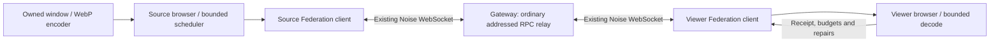

# Federation push route

The experiment defaults to `PWRWIN_TRANSPORT=federation`. Source-driven WebP updates, manifests, budgets and repairs all traverse the existing signed/Noise Federation WebSocket clients and a gateway. Direct peer connectivity is unnecessary. `PWRWIN_TRANSPORT=webrtc` retains the earlier direct-UDP comparison path.

This is a runnable developer prototype with disposable in-memory fixture peers, not installed-app window sharing. It starts no production listener, reads no enrolled identity, changes no gateway code, and registers no product capability. Captures remain limited to the explicitly started synthetic AppKit window. General OS input is absent.

## Route and compatibility



The endpoint-only `window.datagram.prototype.v1.push` handler uses ordinary request/response envelopes. The gateway has no window handlers and forwards the addressed method using its existing `gateway_relay` permission. A setup RPC selects the route and creates a new epoch. The source then pushes damage without viewer frame requests. This validates the generic compatibility seam, not a particular older deployed gateway binary or Cloudflare Access configuration.

Two upgraded endpoints should negotiate experimental support and explicit owner grants inside this addressed exchange; an old gateway need not recognize a new transport capability. Wiring that handshake into enrolled desktop runtimes remains future work. Unknown methods on old endpoints must return unsupported. Enrollment alone must not authorize window capture or input.

Noise protects each transport hop. The gateway is trusted and can inspect forwarded image payloads. No claim of end-to-end encryption against the gateway is made. Revocation and Federation disconnect must close the eventual production session, even when a direct WebRTC path is selected.

## Push, cancellation and bounds

- A media push contains at most eight independently versioned fragments, each at most 1,028 bytes including its header. Base64 and JSON keep it compatible with existing RPC envelopes; the full batch is capped at 12 KiB. This adds encoding/serialization overhead compared with a native binary stream.
- Up to six media batches may be in flight. Two additional slots are reserved for control/feedback, with a 96 KiB total serialized-body cap. This is a pipeline, not one-request-per-fragment stop-and-wait. A 4 ms scheduling pass emits a bounded quantum and yields.
- A slot is released after the destination browser dispatches the batch. It does not wait for decoding or painting. A stalled browser has bounded outstanding delivery receipts and a four-second timeout; the sender closes after five seconds without acknowledgment. There is no automatic image retry loop.
- New damage removes unsent obsolete refinements from the existing per-region scheduler. Already handed-off TCP bytes cannot be recalled. Epoch and version checks, including post-decode checks, prevent obsolete work from repainting newer content.
- Lossless tiles repair the current missing regions. Browser assembly, decode and delayed-fault queues retain the existing limits. A logical restart has a new epoch and requires a current manifest plus complete coverage.

TCP/WebSocket remains reliable and ordered, including through a TCP-based proxy. Discarding stale application work cannot remove TCP head-of-line blocking. The implemented bounds limit how much media can get ahead of control traffic; they are not yet adaptive congestion control or a global Federation fair scheduler. Direct UDP/WebRTC remains an optimization for reachable peers.

## Reproduction and measured transport

Run capture/viewer verification with the [standard harness](../../scripts/remote-window-prototype/datagrams/README.md), which now defaults to Federation. For transport-only load with no capture or browser:

```sh
pnpm --filter @pwragent/desktop exec tsx \
  ../../scripts/remote-window-prototype/datagrams/relay-benchmark.mts \
  "$PWD/.local/remote-window/datagrams/relay-transport.json"
```

The test sends six concurrent eight-fragment batches for five seconds through the real encrypted gateway, alongside a small Federation RPC every 100 ms (one probe outstanding). The optional owned loopback TCP proxy rate-limits each direction of each connection to 250,000 bytes/s. It adds no artificial RTT, does not drop packets, and changes no OS/network rules. This is not a Tailscale/Cloudflare deployment test.

Measured 2026-10-22 on the local M2 Max:

| TCP route | Fragment payload throughput | Competing RPC p50 / p95 | Peak concurrent media pushes |
|---|---:|---:|---:|
| Unshaped loopback | 6,552,407 B/s | 8.0 / 14.3 ms | 6 |
| 2 Mbit/s per connection/direction proxy | 156,302 B/s | 272.2 / 512.3 ms | 6 |

Fragment throughput includes the experimental header but excludes base64, RPC envelopes, Noise, WebSocket and TCP. The 2 Mbit/s result includes two shaped relay legs and protocol overhead. These are single short capacity trials with opaque fixture bytes; no image decoding, cross-host latency or photon timing is included. Saturated RPC tail latency is evidence that adaptive pacing and shared traffic scheduling are still required.

## Real capture, relay and browser verification

On the same machine, the owned 800×548 AppKit fixture was captured through ScreenCaptureKit, encoded as WebP, pushed through the actual Noise gateway, and decoded/drawn by a second isolated Chrome instance. No RTCPeerConnection was created (`rtc: []` in all samples). [Reviewed synthetic-only canvas](artifacts/federation-push-canvas.png).

| Injected message drop / delay after delivery | Motion preview presentations/s | Motion fragment B/s | Stop-to-full-refinement | Opaque tile checks |
|---|---:|---:|---:|---:|
| 0% / 0 ms | 28.60 | 263,607 | 216.7 ms | 117/117 |
| 3% / 50–70 ms | 20.29 | 263,613 | 420.4 ms | 117/117 |
| 10% / 100–130 ms | 7.32 | 268,274 | 593.4 ms | 117/117 |

The fault injector drops/delays complete fragments **after reliable delivery**. These are repair/cancellation tests, not TCP packet-loss measurements. Refinement timing starts after the synthetic fixture acknowledges stopping motion, and requires the corresponding pixel beacon plus complete lossless coverage; it is not physical input-to-photon. Each row is one trial, not a latency distribution.

All three approximately two-second idle samples received zero image bytes. Logical restart produced a fresh epoch and matched 117/117 tiles again. Whole-run native capture/encode consumed 3.331 s user + 0.562 s system CPU over 43.066 s, with 123.73 MiB peak RSS. Native encode p50/p95: preview 1.988/2.882 ms (487 samples), tile 0.221/0.412 ms (1,383 samples). Source relay occupancy peaked at six batches / 44,191 serialized body bytes. GPU, energy, browser process resources, cross-host performance and actual Access/Tailscale routes were not measured.

Earlier sequential source/viewer automation checks failed while source generation changed (172→173); later same-version decoded reference checks matched. The final benchmark fetches native versioned checksums over Federation and compares in one viewer operation, avoiding automation switching between the source and viewer during comparison. It still fails on missing tiles, wrong epochs or pixel differences; it does not retry failed comparisons. The initial failed runs remain in ignored local output for diagnosis.

Generated frame-by-frame JSON stays in `.local/remote-window/datagrams/relay-final/`; no raw JSON is committed. Provenance SHA-256:

- `benchmark.json`: `5a60303ab9d3c0cd4bedc059e70326d65992f577aa6b715faf3f9ee1e5fcddb5`
- `result.json`: `d8a635d3ed54cd2bd761b64d3c99cc311aed20e7654522f76a31a57edcbae2a4`
- `logical-reconnect.json`: `d61e54e31583f14398f2199fef9084d8b5cd4dedc038511cbec9c5b48a9ea574`
- `loss-0.1-canvas.png`: `822628d717a64a048af514a36b2a9fe77f0fe7bf9bbbf513c829c285b3db7b68`
- `../relay-transport.json`: `7c6bd6f14228896f6e5648ef1e9e13fbc9f5a7371f67aba2cd2f772e0959ccab`

## Deployment constraints

The route is suitable for testing over an existing WebSocket connection without requiring direct UDP. Cloudflare supports WebSockets but documents that connections can be terminated, including during infrastructure restarts; reconnect must reconstruct current state. Tailscale can use direct or relayed paths, so LAN membership alone is not a reachability/performance guarantee. Neither service was configured or exercised by this change. Sources checked 2026-10-22: [Cloudflare WebSockets](https://developers.cloudflare.com/network/websockets/), [Tailscale relay servers](https://tailscale.com/kb/1232/derp-servers).
