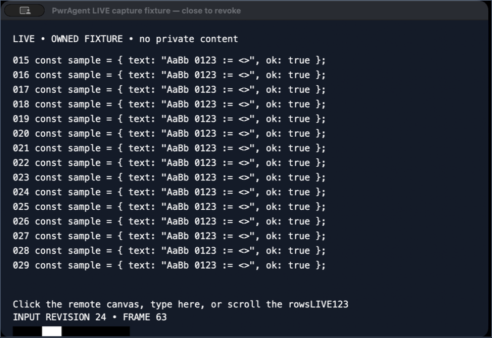
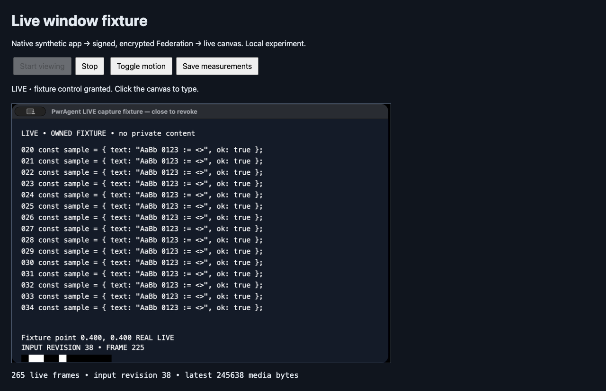
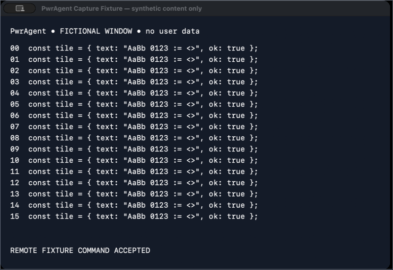

# Single-window Federation viewing: measured prototype and decision

**2026-10-11. Experimental; no product capability enabled, merge, or release.**

The recommended direction is a consented native window-capture helper with two visual modes: pixel-exact, damage-driven tiles for settled text; hardware low-delay video for scrolling and motion, followed by a lossless repair. Keep viewing and control as separate grants. Use Federation for ownership, consent, signaling and initial bounded tile transport; evaluate WebRTC media for sustained motion before committing to a production transport. This is an engineering decision to advance that experiment, not a claim that the current prototype meets RDP/NoMachine quality.

The prototype now has a **continuous native macOS capture → hardware H.264 → real signed/Noise-encrypted Federation → Windows WebCodecs canvas loop**, with a lossless PNG repair after settling and fixture typing and scrolling on the return path. The cross-machine run used the actual opt-in adapters in the M2/dev and Windows/dev applications. It proves live viewing and application-helper interaction, but its **1.25 video FPS during motion and 445.9 ms median observed input latency do not meet the requested responsiveness**. The earlier batch transfer and same-host runs remain separately labeled experiments. No VNC/RFB implementation or dependency is used.

## Continuous live prototype, added after the initial review

See [the runnable live instructions](../../scripts/remote-window-prototype/LIVE.md). The source captures only its own authored native window. Existing Federation routing carries the requests between the two test applications. Frames are produced in response to bounded viewer credit and decoded immediately, not imported from a recording. The operator enrolled the M2/dev profile; the agents did not read or export enrollment credentials. M2/default remained running throughout the test. The Windows application retained its existing dev identity through the temporary build switch.

### Cross-machine result

The receiver ran on an aging Intel machine: the operator identifies the physical host as a 2018 MacBook Pro with Touch Bar and 16 GB RAM. Post-run Federation metadata reports a Windows virtual machine exposing an i7-8559U at 2.70 GHz, four logical CPUs, and 10,736,128,000 bytes of guest RAM (about 10 GiB). Headless Edge used software decoding. The physical host was not independently inspected, and guest resources are not the host's full capacity. These results characterize this particular receiver and routing path; they must not be generalized to current Windows hardware.

| Measurement | Observed result | Scope |
|---|---:|---|
| First viewer run | 16 frames; 1,553,461 media bytes | Includes initial frames outside the benchmark phases; excludes RPC/base64/wire overhead |
| Stable idle | 0 image bytes over 3.0048 s | Control traffic was not counted in this run |
| Motion | 5 H.264 frames over 4.0009 s: **1.25 video FPS** | Plus one PNG repair; 396,817 total media bytes, of which 33,084 were H.264 |
| Input→canvas p50 / p95 | **445.9 / 2,176.9 ms** | Only five exact pixel-beacon matches; 24 commands were accepted |
| Decode + presentation p50 / p95 | 11.3 / 198.5 ms | 16 frames, including the cold first decode; software WebCodecs, no photon measurement |
| RPC ping p50 / p95 | 51.6 / 540.9 ms | 187 samples across the viewer run, including operator wait; not an isolated benchmark-phase RTT |

The reviewed Windows canvas contains `LIVE123`, rows 15–29, and input revision 24. The three-second scrolling phase presented no frames; its final state arrived later. Accepted input commands are therefore not equivalent to promptly displayed states. No viewer errors were recorded. Cross-host wall-clock capture-to-canvas values were excluded because the machines' clocks were not synchronized.

Four PNG repairs consumed 1,457,300 bytes: **93.8% of first-run media**. One 363,733-byte repair took 6,066 ms for its remaining chunk pulls and presentation, completing after the scrolling phase. The timer begins after the first pull response and excludes that initial request/wait and the final acknowledgement; it is neither total frame delivery time nor pure network latency. A roughly 365 KB repair needs 23 chunks, including 22 additional serial RPC pulls. Motion-video encoding p50/p95 was 3.64/4.54 ms and decode/presentation was 6.2/15 ms. This is strong evidence for a full-repair/serial-transfer bottleneck, although capture scheduling, native readback, and wire transit were not isolated. This transport is unsuitable for a production RDP-like experience without substantial changes.

Logical Stop/Start then created epoch 2, decoded a fresh H.264 frame followed by a PNG, retained the fixture state, and left control disabled. This is **logical resynchronization**, not a physical-network reconnect test. Including that separate check, the source produced 18 frames and 1,979,123 media bytes. Hardware VideoToolbox encoding was confirmed. The whole native run, including lengthy operator waits, consumed 8.98 user + 5.25 system CPU seconds over 927.17 seconds, with 96,960,512 bytes maximum RSS. Source helper and fixture exited cleanly after saving results. GPU energy and physical input-to-photon timing were not measured.

Evidence: [combined measurements and boundaries](artifacts/live-crosshost-combined.json), [source raw records](artifacts/live-crosshost-source-raw.json), [Windows browser raw records](../../scripts/remote-window-prototype/windows/benchmarks/windows-live-crosshost-browser.json), and [separate logical-resync result](../../scripts/remote-window-prototype/windows/benchmarks/windows-live-logical-resync.json). The installed Windows application was restored with its original identity after measurement; both M2 applications remained running, and the test helpers were stopped.

### Separate same-host transport baselines

| Live measurement | No added delay | 40 ms added before each viewer RPC |
|---|---:|---:|
| Motion video frames / approximately 4 s | 117 | 29 |
| Input→canvas p50 / p95 | 41.3 / 55.0 ms | 105.5 / 173.8 ms |
| Pixel-observed input revisions | 24 | 20 of 24 accepted actions |
| Stable idle image bytes/s | 0 | 0 |
| No-delay idle control traffic, both directions at viewer | 3,812 B/s | See raw counters |
| No-delay motion media, including repair overlap | 125,600 B/s | 99,175 B/s |
| No-delay motion traffic at viewer, both directions | 191,515 B/s | See raw counters |

These are **same-host**, real encrypted-protocol observations, not cross-host/WAN claims. The delay is an application perturbation, not physical RTT or packet loss. Timing ends at canvas drawing plus an animation callback, not physical photons. A 12-bit luminance beacon is drawn by the native app; only decoded pixels matching an accepted input revision produce a timing sample. With delay, newer captured states can replace intermediate revisions; the 20 samples must not be represented as all 24 actions individually observed.

The delayed run establishes a concrete failure of this compatibility transport: one-frame credit plus stop-and-wait chunk/ACK RPCs becomes RTT-bound. Its 16 KiB media chunks are base64 inside unchanged RPC envelopes; measured counters include envelope and Noise bytes, excluding WebSocket/TCP headers and handshake. This is a working initial transport, **not the efficient final binary/media design**. A credit-driven push path or WebRTC trial is required before claiming RDP-like responsiveness over a WAN. Input is independent of a pending idle pull; serializing input behind that poll initially cost about 400 ms and was fixed.

Hardware VideoToolbox encoding is used. A headless Chrome hardware-decode support query succeeded but the first frame timed out; the working viewer explicitly uses software WebCodecs decoding. Windows likewise used software decoding for the successful cross-machine run. Its earlier `avc1.42E01F` support query alone was not treated as proof of frames or hardware use.

Settled-text PNG repair restores the captured image, but costs roughly 250–320 KB per full repair in this fixture. It can dominate a short typing/settling phase and needs damage tiling or a better lossless encoding before product use. Repeated identical native buffers send no media; idle control traffic is still too chatty. The lossless-repair image below is an actual remote-protocol canvas. The native process in the no-delay run consumed 1.77 user + 0.99 system CPU seconds over 125.09 wall seconds, with 100,466,688 bytes maximum RSS; that whole run includes substantial idle/operator time, not just the motion phase. No GPU/energy or physical-display measurements were obtained.

Numeric results: [no-delay summary](artifacts/live-loopback.json), [no-delay raw](artifacts/live-loopback-raw.json), [delayed summary](artifacts/live-delay40.json), [delayed raw](artifacts/live-delay40-raw.json). Reconnection creates a new epoch and forces a keyframe; fixture control is not automatically restored. The adapter is disabled by default, ignored by packaged apps, pinned to one configured peer, token-protected on loopback, method/body/concurrency bounded, and disposed with the runtime. Its tests cover peer spoofing, browser-origin rejection, wrong tokens/methods, missing helpers, disconnect and shutdown. It makes no per-frame SQLite writes.

## Evidence and boundaries

| Path | Actual result | Limit |
|---|---|---|
| macOS single own window, SCK | Visible, fully covered by another owned window, offscreen, minimize/restore and resize exercised | One AppKit fixture on macOS 26.6.2/M2 Max; not a promise for every app |
| Native SCK → VideoToolbox | Hardware-required H.264 capture/encode measured at 1×/2×; live Mac→Windows WebCodecs loop at 1× | Live motion only 1.25 video FPS in the cross-machine run; no photon measurement |
| macOS → Windows live Federation | 16 first-run frames; 24 accepted helper commands; five pixel-matched input samples | Slow serial RPC transport; software decode; fixture interaction only |
| macOS → Windows Federation | Real 4,191,302-byte batch delivered; 90 frames replayed on Windows | File transfer, JSON/base64 overhead, setup and batch delay; not interactive streaming |
| Windows → macOS helper → Windows | 159-byte command transferred, own app changed text, recaptured response rendered and visually checked | App helper action; **not** general OS keyboard/mouse injection |
| Windows WGC | Initial disconnected probe: zero frames. Active-desktop follow-up: 47 visible, 44 obscured, 47 resized, 48 restored frames in about 2.2 s per stage | Minimized: two transition frames, then no settled output. One owned GDI fixture at 192 DPI; not arbitrary-app proof |
| Windows PrintWindow | Own GDI fixture rendered at 192 DPI; resize changed dimensions | Synchronous app-rendering fallback; no evidence for arbitrary GPU windows |
| Linux | Current portal, PipeWire, XComposite and input paths evaluated from primary sources | No connected Linux peer; no Linux capture/input experiment |
| Different Spaces, screen lock, protected content | Not experimentally tested | Fail closed; no operator session lock/Space changes or protection bypass |

Raw **numeric** results and inspected visual outputs are in [artifacts](artifacts/). Reproduction commands are in [the prototype README](../../scripts/remote-window-prototype/README.md). Windows implementation, guard, results and primary references are in [the Windows report](../../scripts/remote-window-prototype/windows/README.md); the subsequent [active-desktop capture/input results](../../scripts/remote-window-prototype/windows/active-desktop.md) preserve the new measurements and reviewed WGC PNG. The [Windows experiment](pwragent://thread/01a12c12-a4e0-7130-8e72-e470a0041ed6?backend=codex&instanceId=pwr_e87183a6-755f-49be-8df2-a28b3231960d) began on Astra/high. At the operator's request, cross-machine testing moved to Sol/high in that thread and the [M2/dev test thread](pwragent://thread/01a12ddf-2455-7933-812d-dd73bdd96e1d?backend=codex&instanceId=pwr_7bd451d0-df75-4676-84f7-bbcbfc565bce).

All captured pixels come from authored fake-data windows. No desktop-wide capture, credential capture/export, private user content, clipboard, audio, agent-created enrollment, firewall change, runner drain, or unrelated checkout build was used. Windows profiles on the same host were counted as one machine. Connected status was reverified, then actual desktop readiness was checked; it proved weaker than the Federation connection status.

## What the macOS experiment establishes

The 800×548 PNG-instrumented run received 117 callbacks during full occlusion and 118 offscreen, with changing pixel hashes. Minimizing produced one transition frame and `SCFrameStatus.suspended`, then no live updates. Restore resumed updates. This refutes the blanket proposition that macOS always renders every window, while supporting desktop-independent capture of this obscured/offscreen window. Apple documents the distinction between single-window and display/app filters, including paused minimized output. App/display capture has different offscreen and child-window semantics; it cannot be substituted without changing the sharing contract. [Apple, WWDC22 ScreenCaptureKit session](https://developer.apple.com/videos/play/wwdc2022/10155/).

A fixed 800×548 stream remained fixed-size through source resize; `contentRect`/scale metadata changed. The prototype therefore demonstrates resize observation and scaling, not a finished native-resolution resize protocol. 1600×1096 tests exercise higher pixel count on a Retina source. Cross-monitor scale migration, other Spaces, protected surfaces and locked sessions remain untested. A stale last frame must be labeled paused or unavailable, never presented as proof that the app remains live.

The captured “idle” interval had three distinct RGB images: title-bar changes and a later whole-window appearance change. Identical-frame stretches produced **zero tile image bytes**. Over the entire three-second saved 1× sample, including the initial state and those transitions, lossless WebP tiles averaged **107,763 B/s**. The longest observed stable stretch was 60 saved frames. Control keepalives and framing are excluded from these image-byte figures.

PNG instrumentation is deliberately not a production capture pipeline. Median callback time, including Core Image readback, PNG compression and synchronous disk writes, was about 12–13 ms at 1× and 56–58 ms at 2× during scrolling/occlusion. The latter exceeds a 33.3 ms frame budget and distorts timer cadence. The 1× run took 37.14 s, consumed 10.59 CPU seconds and peaked at 105.9 MB RSS; the 2× run took 39.70 s, consumed 30.99 CPU seconds and peaked at 114.6 MB. These are whole fixture/capture-process figures, excluding WindowServer and GPU energy. GPU utilization and energy counters were unavailable; no energy estimate is invented.

The separate native benchmark feeds SCK pixel buffers directly into a hardware-required `VTCompressionSession`, with realtime mode, no frame reordering, 1.5 Mbit/s requested average bitrate, and a 60-frame key interval. It does not perform per-frame PNG export. Consult [capture-native.json](artifacts/capture-native.json) for sequential-run phase durations, actual encoded bytes, latency distributions, errors and resource totals. Encoded bytes exclude container and transport overhead. Encode latency starts at the capture callback, so it excludes application rendering, WindowServer scheduling, network, decode and scanout. Apple's low-delay H.264 path is relevant here; WebCodecs hardware preferences alone are not guarantees. [Apple VideoToolbox low-latency session](https://developer.apple.com/videos/play/wwdc2021/10158/), [WebCodecs specification, 2026-10-07 draft](https://www.w3.org/TR/2026/WD-webcodecs-20261007/).

The final sequential native runs completed without stream-stop or encode errors. Scrolling results:

| Live native path | Encode p50 / p95 | Encoded payload B/s | Whole-run CPU seconds / wall seconds | Max RSS |
|---|---:|---:|---:|---:|
| 800×548, hardware H.264 | 3.50 / 4.48 ms | 132,322 | 3.36 / 36.96 | 105.3 MB |
| 1600×1096, hardware H.264 | 7.12 / 7.82 ms | 210,764 | 2.43 / 36.63 | 104.5 MB |

These are single runs on a shared, loaded host; the lower 2× CPU total is not evidence that higher resolution is cheaper. Both exclude encoder/GPU/WindowServer work outside the fixture process. The requested 1.5 Mbit/s average bitrate is not a hard per-phase ceiling. Native mode currently submits repeated complete frames during idle; it does not implement the proposed damage gate or hybrid repair.

## Codec comparison: measured costs, not equivalent quality

Each offline 1× sample contains 90 saved captured frames replayed at 30 fps. Source capture cadence is not inferred from this replay clock. PNG and WebP tile scans use 128×128 tiles and SHA-256 over RGB. The current implementation scans every tile and has no cross-position content cache; a cache, native damage metadata, batching and scroll-copy detection remain optimizations to validate.

| 800×548 scene | Lossless WebP tile image B/s | Hardware H.264 file bytes / 3 s | VP9 file bytes / 3 s | SVT-AV1 file bytes / 3 s |
|---|---:|---:|---:|---:|
| Idle including transitions | 107,763 | 168,182 | 81,535 | 83,382 |
| Typing | 506,157 | 189,704 | 107,231 | 109,711 |
| Scrolling | 1,038,538 | 248,456 | 199,799 | 259,475 |
| Motion rectangle + counter | 502,137 | 198,856 | 128,217 | 131,522 |

Video cells are **whole file sizes**, not B/s, and include their MP4/WebM container. Divide by three only to estimate replay-average bandwidth. They are lossy 4:2:0 outputs with different quality controls; smaller does not mean better. H.264 used a 1.5 Mbit/s bitrate request, software x264 CRF23/ultrafast/zerolatency, VP9 realtime CPU8/CRF32/no lookahead, and SVT-AV1 preset12/CRF35/screen-content mode. SVT encoding here is an offline trial, not validated low-delay conferencing. Commands, exit status and wall throughput are retained in [codec-1x.json](artifacts/codec-1x.json); [codec-2x.json](artifacts/codec-2x.json) contains HiDPI image trials.

The software harness measured full-frame encoding **plus** tile hashing/encoding together: the lossless WebP median was 61–81 ms at 1× and 317–495 ms at 2×. Those totals must not be represented as optimized tile-only codec latency. Reproduction code now records the two components separately as well. The image path is pixel-exact against captured RGB in every reconstructed frame, checked in [lossless-verification.json](artifacts/lossless-verification.json). That does not recover detail already lost by capture scaling. The lossy video's first-frame text-region RGB error is recorded in [quality.json](artifacts/quality.json); this is neither OCR accuracy nor a full motion-quality metric.

| Option | Engineering judgment |
|---|---|
| PNG/WebP + damage tiles | Strong settled-text fidelity, simple independent repair, useful for sparse UI. Scrolling, noise, transparency and many small encodes can dominate. Batch damage, suppress unchanged content, use bounded cache; do not send periodic full screenshots while idle. |
| Hardware H.264 | Practical first motion mode because native encode and browser decode are widely available. 4:2:0 can damage colored text; use full-resolution lossless repair after motion stops. Measure hardware availability, delay and color conversion on each machine. |
| VP9 / AV1 | Worth negotiating where hardware and software deadlines permit. AV1 includes palette and intra-block-copy tools for screen content, but a codec name does not establish that a particular encoder enables them or meets latency/power limits. [AOM algorithm description](https://aomedia.googlesource.com/aom/+/refs/heads/main/doc/AlgorithmDescription.md). |
| Lossless video alone | Does not solve capture suspension, app focus, GPU readback, chroma conversions, transport queues or frame dependency recovery. Must establish end-to-end pixel format and decoder support. |
| Hybrid | Recommended hypothesis: motion video, then an epoch/sequence-bound lossless repair when damage settles. Keep the repair from being overwritten by an older video frame. Validate switching hysteresis, extra keyframes and repair cost before shipping. |

WebP is an image coding/format family; PNG is a lossless image format. H.264, VP9 and AV1 are video codecs. WebM and MP4 are containers, not competing codecs. WebRTC is a real-time transport/media stack, and WebCodecs exposes codec processing rather than providing transport. [WebM container specification](https://www.webmproject.org/docs/container/), [WebCodecs specification](https://www.w3.org/TR/webcodecs/).

## Transport measurements and decision

The real Federation forward batch was 4,191,302 bytes and took 2,541 ms tool wall time including setup and receiver acknowledgement. This is approximately 1.65 MB/s at that API boundary, not a raw link capacity measurement. JSON/base64, envelopes, compression, relay behavior and file persistence are included or layered underneath; there is no packet-level byte counter in this result. The reverse 159-byte helper command took 188 ms at the remote tool boundary. Cross-machine clocks were not synchronized, so `issuedTimeMs` was not subtracted from a remote timestamp.

Windows Edge headless imported the scrolling batch in 454.2 ms, then played 90 frames in 2,996.7 ms with decode+draw p50 **12.0 ms**, p95 **14.9 ms**. Local Mac headless Chrome replay measured p50 4.0 ms and p95 6.4 ms. These include software image decode/canvas drawing and exclude real display scanout. Initial full-frame decode is more expensive: the verified input response decoded/drew in 66 ms on Windows. Source-side helper acceptance preceded a stale callback by 26.7 ms and a later visually confirmed changed capture by 173.6 ms. No input-to-photon result was measured.

The [loopback experiment](artifacts/link-benchmark.json) sends a fixed real 169,249-byte fixture packet through actual TCP in 16 KiB quanta, keeping one in-flight snapshot plus the newest pending snapshot. It injects application-level bandwidth limits, one-way delay and deterministic retransmission-like stalls. Measurement revision 2 delays each packet before writing it to TCP, then adds propagation at the receiver. This corrects the original implementation, which could record delivery before paying the final chunk's serialization/stall cost; the table and artifact below have been regenerated. It is **not kernel packet loss**, WAN testing or a WebRTC congestion-control comparison.

| Scenario | Delivered / dropped snapshots | Frame age p95 | Small event delay p95 |
|---|---:|---:|---:|
| Loopback, nominal 1000 Mbit/s | 87 / 2 | 26.6 ms | 22.0 ms |
| Emulated 10 Mbit/s, 50 ms RTT | 21 / 66 | 243.9 ms | 41.6 ms |
| Emulated 2 Mbit/s, 100 ms RTT, stall each 33 chunks | 5 / 72 | 996.0 ms | 172.3 ms |

The review's 16,000-byte single-packet case was also rerun: median frame age was **148.5 ms** at 2 Mbit/s and 50 ms one-way propagation, above the 114.056 ms serialization-plus-propagation floor. See [the regression measurement](artifacts/link-single-packet-regression.json). This case uses synthetic zero bytes and is separate from the captured-window workload.

The key finding is boundedness, not a claimed production latency: replacing queued snapshots prevents minutes of stale video, and interleaving small events avoids placing them behind the whole frame. Frame size still makes low-bandwidth latency unacceptable. At 2 Mbit/s, a 169 KB full snapshot takes roughly 0.68 s to serialize even before other delays. Adaptive resolution, sparse damage, motion codec bitrate and preemption are necessary. Timer granularity and Node instrumentation affect the loopback numbers.

**Federation binary stream:** reuse authenticated routing and backpressure, with a separately negotiated window capability and bounded media quanta. Existing `blob_chunk` transport already has binary framing, while ordinary RPC results are JSON. Avoid base64 media inside high-rate RPC and synchronous Brotli recompression of already compressed images/video. Existing 2 MiB socket high-water and 16 MiB frame ceilings are safety ceilings, not latency budgets. The prototype's actual Router/RPC test demonstrates integration shape; no new handler is registered in running peers.

**WebRTC:** preferred candidate for sustained low-delay video because it supplies congestion control, media pacing and codec negotiation. Federation should carry authenticated signaling and bind DTLS fingerprints to the approved peer/session. TURN availability, relay policy, endpoint identity, revocation and NAT behavior require a separate measured trial. No new public relay or firewall permission was assumed here. A data channel still needs bounded queues; reliable ordered control and disposable media have different requirements. [W3C WebRTC](https://www.w3.org/TR/webrtc/), [RFC 8834 media transport](https://www.rfc-editor.org/rfc/rfc8834.html).

**QUIC/WebTransport:** possible later transport with independent streams/datagrams, but certificate/origin support, discovery and Electron integration add work. It is not justified before the native capture/input contract and WebRTC trial. **RDP/RemoteApp/NX:** useful quality references and possible platform-specific integrations under their deployment/licensing constraints; this work does not recreate those protocol ecosystems. Cropping a desktop-sharing stream is not single-window isolation.

Service forwarding is deliberately independent. The sibling's `service_forward_v1` and user-connected advertised loopback services are not an implicit transport or permission grant for window capture. This PR does not modify its modules, the Forge bridge, backend registry, gateway dedupe or mobile work. Runtime changes are additive startup/disposal for the explicit development adapter; no default capability or product UI is enabled.

## Proposed protocol and security contract

These are productization requirements unless identified as implemented in the experimental state machine.

1. Negotiate `window_view_v1` separately from `window_control_v1`, with codecs, tile formats, alpha/color space, maximum pixels, FPS, in-flight bytes, input methods and pause reasons. An enrolled device is not automatically authorized to capture a window. Source-local selection and an explicit viewing grant are required. Use system pickers/permission prompts and retain their indicators. No arbitrary remote HWND/window-ID selection.
2. Bind a random session and scene ID to the authenticated owner instance, selected app process **and process lifetime**, native window lifetime and viewer instance. Native IDs and PIDs can be reused. A scene is a set of explicitly selected surfaces with z-order, offsets and modality; new app windows/dialogs do not automatically inherit consent. Scene IDs must not expose a global window inventory.
3. Carry session, epoch, geometry epoch, frame sequence, base sequence, capture timestamp, content rectangle, point/pixel scale, color description, damage rectangles, and keyframe/repair flags. Resize, content switch, reconnect, codec switch and discontinuity reset dependencies. Apply a damage frame atomically only after all bounded pieces decode. Gap, unknown base or missing cache entry requests resync; do not paste a delta over the wrong base.
4. Keep one in-flight frame plus a newest pending snapshot; cap sessions, pixels, encoded bytes, decoded surfaces and cache memory. A provisional budget is two 8 MP RGBA surfaces (64 MB) plus a 32 MB tile LRU per viewer, separately accounting for browser/native/GPU copies. Negotiate lower limits for multiple windows. Cache keys include pixel format, scale and epoch. Eviction requires explicit cache-miss/resync handling. These are proposed caps, not measured process-memory guarantees.
5. Schedule media in 16–32 KiB quanta with per-peer and global byte budgets; reserve service for turns, RPC responses and input. Use receiver acknowledgements, encode queue depth, RTT, buffered bytes and missed presentation deadlines to reduce FPS/bitrate/resolution. Do not spawn an encoder per tile or unlimited surface. Drop before encode when possible. Dropping dependent codec frames needs keyframe recovery; dropping a tile delta requires regenerating against acknowledged state. The tested state machine deliberately uses independent snapshots to avoid that mistake.
6. Reconnect creates a new epoch, invalidates prior frames/input and requires a fresh keyframe. Control lease does not survive automatically. Disconnect/revocation/window destruction/lock stops capture, releases held keys/buttons, clears caches and outstanding RPCs, and marks the viewer unavailable. The state-machine tests cover peer mismatch, revoked sessions, old epochs, replayed/stale input, immutable in-flight snapshots and newest-only pending state. Product disconnect hooks remain unimplemented.
7. Never trust payload `ownerInstanceId` as authorization. `FederationRouter` validates origin and a configured relay hop; adapters must bind the validated origin. Current transport supports Noise IK, signing/enrollment, revocation and reconnect, but this report does not claim media is end-to-end encrypted against every gateway configuration. Document where the relay can decrypt. WebRTC signaling must inherit pairing/revocation without accepting arbitrary peer-supplied URLs or fingerprints.
8. Input carries session/scene/geometry epoch, monotonic input sequence, displayed-frame sequence and source-issued freshness lease. Validate on the source clock, not unsynchronized viewer time. Reject stale geometry, unfocused/unavailable surfaces, denied control, replay and peer mismatch. Keep cursor movement coalescible; preserve ordered key/button transitions. No queued typing after reconnect. Provide an immediate source-local stop and an unmistakable control indicator.

The browser prototype bounds batch bytes, pixels, frames and tiles, requires a complete first keyframe and unique 128-pixel-grid cells for every delta (at most one canvas of declared decoded pixels per frame), checks sequences and decoded dimensions, fences asynchronous imports/decode/presentation by their original generation, releases image bitmaps, and has a network-denying CSP. It is a fixture viewer, not a hardened untrusted media service. Productization still needs decoder isolation, predecode dimension checks, malformed-image fuzzing, resource accounting, focus handling and accessible navigation. The canvas has an accessible label/status but does **not** expose remote text semantics to screen readers. A separately consented, minimized accessibility tree or app helper may improve that; do not silently export full AX/UIA trees.

## Platform input and capture boundaries

**macOS:** SCK capture consent and Accessibility/input-posting authority are separate. The experiment's screen-capture preflight was true and Accessibility trust false. General remote input was therefore not attempted. For a real control trial the operator must enable the actual signed helper/launching app in **System Settings → Privacy & Security → Accessibility**; capture may separately need **Screen & System Audio Recording**, or the supported content-sharing picker flow. Names vary by OS. Do not bypass prompts or reuse another app's authorization. AX actions can target semantic controls but do not cover arbitrary canvas content. CGEvent coordinate injection can affect the wrong frontmost window unless focus, app lifetime and geometry are revalidated. Menus, sheets, Spaces and keyboard/IME composition need separate tests. Apple exposes a post-event permission preflight; absence must be a capability failure, not silent success. [CGPreflightPostEventAccess](https://developer.apple.com/documentation/coregraphics/cgpreflightposteventaccess()).

**Windows:** use WGC for a selected HWND and D3D surfaces, checking active session/input desktop and recreating frame pools on valid size changes. DWM thumbnails are local composition, not a generic encoded transport. Desktop Duplication captures an output desktop, with dirty/move information; it does not recover obscured window content or provide the same isolation as a window source. `PrintWindow` is synchronous cooperation from the target app; its success here establishes only the authored GDI fixture. [Microsoft screen capture](https://learn.microsoft.com/en-us/windows/apps/develop/media-authoring-processing/screen-capture), [Desktop Duplication](https://learn.microsoft.com/en-us/windows/win32/direct3ddxgi/desktop-dup-api), [PrintWindow](https://learn.microsoft.com/en-us/windows/win32/api/winuser/nf-winuser-printwindow).

`SendInput` is subject to UIPI and foreground focus; `SetForegroundWindow` can be refused. UI Automation can offer semantic actions but has coverage/integrity limits. Secure desktop/UAC/lock is unavailable, not a reason to elevate or move sessions. A per-monitor-v2 helper must transform source client pixels, client origin, content crop, scale and viewer letterboxing; never treat browser CSS pixels as native screen coordinates. After the operator restored the authorized session, the guarded follow-up delivered WGC frames while visible, obscured, resized and restored; minimized output stopped after two transition frames. A separate foreground fixture test received an F8 keydown from two SendInput events and a PostMessage click. The measured 208.557 ms includes an intentional observation wait, not injection latency. This is local fixture OS-input evidence, separate from remote application-helper input. No automatic reconnect or lab change was made. [SendInput](https://learn.microsoft.com/en-us/windows/win32/api/winuser/nf-winuser-sendinput), [SetForegroundWindow](https://learn.microsoft.com/en-us/windows/win32/api/winuser/nf-winuser-setforegroundwindow).

**Wayland:** use the ScreenCast portal's source selection and PipeWire stream; inspect backend-supported window source types, cursor modes, dimensions and transform. Capture does not authorize injection. RemoteDesktop portal/device selection and EIS/libei integration are the relevant separate path where supported. Restored sessions/tokens follow portal policy, never bypass consent. Portal version and compositor/backend behavior vary, including minimized/background capture. DMA-BUF/zero-copy is conditional on negotiated formats/modifiers; CPU map/readback may be necessary. No supported Linux result is claimed here. [ScreenCast portal](https://flatpak.github.io/xdg-desktop-portal/docs/doc-org.freedesktop.portal.ScreenCast.html), [RemoteDesktop portal](https://flatpak.github.io/xdg-desktop-portal/docs/doc-org.freedesktop.portal.RemoteDesktop.html), [PipeWire capture tutorial](https://docs.pipewire.org/page_tutorial5.html).

**X11:** XComposite redirection plus XDamage can provide window backing pixels without sibling occlusion. On map/resize the named pixmap must be refreshed; retaining the old pixmap after unmap does not establish live minimized content. GPU/compositor behavior and transient windows still need tests. XTest input is broadly privileged and focus dependent, not a strong per-window security boundary. Xwayland cannot stand in for native Wayland capture/control. [X.Org Composite protocol](https://xorg.freedesktop.org/archive/current/doc/compositeproto/compositeproto.txt), [X.Org XTEST](https://www.x.org/releases/current/doc/xextproto/xtest.html).

Cursor should eventually be a separate shape/position channel with hotspot, scale and ownership; exclude it from pixel damage when possible. Clipboard is off by default, separately granted by direction and type, size bounded and never auto-read. File transfer, drag/drop, clipboard, audio and accessibility extraction must not be accidentally inherited from view/control grants.

## Productization gates

1. **Native correctness:** signed helper, system source picker, explicit stop, real app matrix, obscured/offscreen/minimized/Spaces/lock/protected surfaces, DPI/resize/cursor, lifecycle identity. Extend the successful active-desktop Windows fixture probe to representative applications; test Linux under at least GNOME and KDE Wayland plus an X11 compositor. Record denied permissions as results.
2. **Live visual transport:** replace the measured serial RPC media path with independent `window_view_v1` binary framing and global fair scheduling, revocation and reconnect. Benchmark simultaneous turns/events. Compare it against WebRTC at measured 10/50/100 ms RTT, 2/10/100 Mbit/s and actual 0/1/3% packet loss in an approved network emulator. The working compatibility prototype does not pass this performance gate.
3. **Fidelity/performance:** native damage extraction, GPU-to-encoder path, video-to-lossless repair, bounded tile cache, text/color inspection at native resolution and 2×, real scrolling/video, multiple windows, CPU/GPU/RAM/energy. Targets to test, not achieved promises: stable idle image bytes near zero; responsive control below 100 ms on a suitable low-latency link; no media-caused turn/event stalls; bounded memory after repeated reconnects.
4. **Control:** separate source-local grant, semantic helper/AX/UIA/EIS choice, foreground verification, coordinate epochs, input lease/replay defense, local takeover, held-key release, IME and modal windows. Measure source acknowledgement, first changed captured frame, remote presentation and external input-to-photon separately.
5. **Review before product UI:** malformed stream and permission tests, security review of relay trust and media decoder boundary, accessible viewer design, user-visible pause/revocation states, operational docs in the operator documentation repository. Only then consider a shipped UI or release.

An early concurrent native run lost its SCK connection, and a later 2× fixture run aborted in CoreText drawing. Both failed attempts are retained in [native-investigation.json](artifacts/native-investigation.json) and excluded from primary sequential results. The fixture now retains drawing attributes for its lifetime; the exact exception root cause is not established.

Primary sources linked above were checked on **2026-10-11**. Older protocol/WWDC documents are cited for their actual documented semantics; they do not substitute for current platform tests. Unavailable GPU/energy counters, missing Linux/Spaces/lock tests, Windows arbitrary-application coverage, unmeasured live WAN video and unmeasured general OS input remain explicit gaps.
