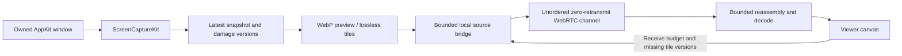

# Source-driven WebP datagram experiment

This stack replaces the baseline's serial 16 KiB pull/ACK loop **in a separate runnable experiment**. The source pushes on damage. A coarse preview takes priority over refinements; new movement cancels queued refinements; the viewer requests only repair of missing current tiles. There is no frame-pull RPC in this path.

This is an opt-in developer script, outside desktop startup and packaging. It adds **no production capability, UI, listener, enrollment, or identity-store access**. The preceding PR's development-only bridge remains disabled by default and ignored by packaged apps. Neither PR is a shippable remote-app feature. Do not interpret the experimental RPC method name as a negotiated Federation capability.

## Run and reproduce

Use this checkout's dependencies, Xcode command-line tools, an operator-installed libwebp, Python 3, and `agent-browser`. The measured macOS build used libwebp 1.6.0 under `/opt/homebrew`; set `PWRWIN_WEBP_PREFIX` for another prefix. No installer or production app restart runs here.

```sh
# From the repository root; outputs remain under ignored .local/.
bash scripts/remote-window-prototype/datagrams/build-native.sh
pnpm --filter @pwragent/desktop exec tsx ../../scripts/remote-window-prototype/datagrams/demo.mts
```

The harness writes `.local/remote-window/datagrams/run/ready.json`, mode 0600, with ephemeral source/viewer URLs. Opening its source URL explicitly starts a newly created synthetic window and capture of **that owned window only**. macOS Screen Recording permission must already allow the launching process; a denial is reported, not bypassed. Open the viewer URL in a separate browser instance and press Start. Closing the source page stops its fixture and the harness. Ctrl-C also stops the owned processes, and a ten-minute maximum lifetime bounds abandoned runs. The URLs contain per-role bearer tokens valid for the harness lifetime; never commit them.

For repeatable tests, start the harness above, then in another terminal:

```sh
python3 scripts/remote-window-prototype/datagrams/benchmark.py \
  --ready .local/remote-window/datagrams/run/ready.json \
  --output .local/remote-window/datagrams/run
python3 scripts/remote-window-prototype/datagrams/summarize.py \
  .local/remote-window/datagrams/run
```

The runner creates and closes two uniquely named isolated `agent-browser` sessions. It never attaches to a user's browser. Two instances avoid background-tab timer throttling on the source. Fixtures, browser logs, tokens, generated JSON, and canvas PNGs stay in `.local/`. The PNG is read from the owned canvas backing pixels so a short headless viewport cannot clip the evidence. Benchmark controls change only this synthetic AppKit view through its private parent pipe; they are **not remote OS input**. No app accessibility privileges, global input, clipboard, or private windows are used.

Validation:

```sh
pnpm test scripts/remote-window-prototype
node node_modules/typescript-native/bin/tsc --noEmit --skipLibCheck \
  --moduleResolution bundler --module esnext --target es2022 \
  --allowImportingTsExtensions --esModuleInterop \
  scripts/remote-window-prototype/datagrams/demo.mts
pnpm lint:oxlint
pnpm lint:oxlint:typed
pnpm typecheck
```

## Data path and cancellation



The capture is fixed at 800×548. Native code compares a 64-pixel grid: 13×9 = 117 non-overlapping tiles. Unchanged pixels generate no image traffic. Damage affecting more than 24 tiles, or another change within 120 ms, emits a fast 200×137 lossy WebP preview (quality 45, method 0). The viewer applies it only to regions newer than their displayed pixels, preserving unchanged sharp text. After 120 ms quiet, lossless WebP tiles (method 0, quality 0 effort setting, exact mode) replace damaged regions. Quiet small updates can skip the preview. This heuristic still needs tuning for rapid typing and mixed text/motion.

There is one native encode worker and one replaceable latest snapshot. It rechecks the generation before and after each bounded tile encode. On new damage the sender discards obsolete queued work, including pending refinements when movement resumes. Work already handed to SCTP cannot be recalled; its queue is bounded and the receiver checks region versions again **after asynchronous decode**, so late work cannot roll pixels back. Coarse updates can display while a newer manifest is in flight, provided that region has not already drawn a newer version.

Each binary message has a 28-byte header and at most 1,000 payload bytes. The header binds a connection epoch, region/version, image kind, total size, and fragment index/count. Each tile is independently decodable. Missing one tile never prevents complete neighbors from drawing. Missing regions are requested in batches of at most 16 after damage quiets; repair requeues the **latest cached tile**, not a historic frame. Partial previews are expendable. Fragment reassembly expires after 250 ms; old epochs and obsolete tile versions are rejected. Stop/Start creates a new random epoch and reconstructs from the current source cache.

## Transport, pacing, and trust

The harness uses the actual `FederationGatewayWebSocketServer`, `FederationRouter`, `FederationRpcEndpoint`, signed identities, and Noise handshakes to exchange SDP. Three disposable identities and trust records exist only in RAM, with an isolated temporary PwrAgent home. Signaling is addressed to the pinned synthetic owner/viewer, not an enrollment API. The authenticated offer/answer exchange binds the WebRTC DTLS fingerprints. Media then travels directly over WebRTC, **not through the Federation WebSocket, a TCP tunnel, or service forwarding**. The local native/browser WebSocket is a loopback adapter, not the inter-peer media transport.

The media channel uses `ordered:false, maxRetransmits:0`. The reliable ordered feedback channel carries tiny coalesced manifests, receive allowances, and repair requests. Both share SCTP congestion control. The prototype checks that the selected ICE candidate uses UDP and fails closed on a TCP path. There are no public STUN/TURN servers, new firewall rules, or production gateway changes. This measured route is loopback only; cross-host ICE/TURN, relay policy, authenticated consent, revocation, and production capability negotiation remain deployment work.

The sender has a 10 Mbit/s static pacing cap, an eight-message scheduling quantum, and a 64 KiB `bufferedAmount` threshold. The viewer grants a **replacement**, non-accumulating allowance of at most 64 KiB every 50 ms while damaged tiles remain, expiring after 250 ms. Lost messages cannot strand ACK credits. Idle skips these allowances and repair messages; WebRTC's own keepalives remain. This is bounded flow control, not a measured adaptive bitrate algorithm. SCTP handles actual network congestion; the injected loss tests do not exercise that control loop. On a sufficiently slow path, repeatedly replacing fragmented previews can starve coarse presentation; adaptive preview size/cadence or a bounded in-progress preview is required before shipping.

There is no unbounded image backlog: latest per-region cache only, at most 32 partial assemblies / 512 KiB total, at most 32 completed encoded images / 128 KiB awaiting decode, and two concurrent bitmap decodes. The test fault injector is also capped at 512 KiB. Headers and WebP coded dimensions are checked before decode; oversized, animated, mismatched, or unsupported image shapes are rejected. The fixed canvas and grid prevent overlapping giant-tile allocation. These bounds exclude Chromium/SCTP internals. Connection generations fence late browser work after reconnect.

The viewer canvas exposes a descriptive accessible label, not a semantic tree for the remote app. There is no remote keyboard/mouse or clipboard support in this stack. Production input must retain independent owner grants, capture freshness, focus, geometry/DPI mapping, revocation, idempotency, and OS permission checks. Media loss must never become permission to replay input.

## Measured result and limits

See [the compact measured report](../../../docs/remote-window-prototype/PUSH-MEASUREMENTS.md) and [reviewed synthetic canvas](../../../docs/remote-window-prototype/artifacts/push-webp-canvas.png). The report distinguishes image bytes, feedback, native encode time, browser decode/draw, CPU/RSS, and pixel-verified refinement. Raw JSON is deliberately not versioned. The original live Mac→Windows pull-path evidence remains in the parent PR; this push-path run was **same-host**, with no Windows, Linux, 2× capture, energy/GPU, real packet-loss, or physical input-to-photon measurement. It cannot establish a cross-host speedup over the earlier 2018 Intel MacBook Pro Windows receiver.

The baseline quiet interval sent zero image or feedback bytes. Later nominal idle intervals contained new full-window native versions and hundreds of KiB; the report retains that anomaly. Its cause was not isolated. Quiet-source scheduling, capture indicators/activation, and redundant full-window invalidations need further investigation before making an idle-bandwidth product claim.

WebP was not rejected for license or availability. It provides both lossy previews and independent lossless text repairs; PNG repair bursts in the baseline were a shortcut. This experiment links the operator's libwebp and vendors no codec. Its upstream BSD-style license is compatible with the project's existing allowlist, but packaging a pinned build still requires the normal dependency/disclosure review. WebP is an image format using VP8-based lossy compression or its lossless codec; WebM is a container, and WebRTC is transport/session machinery. None is a substitute for the others.

## Next productization steps

1. Validate this push path across the enrolled Mac and Windows test peers, retaining identities and using development profiles only. Negotiate an explicitly experimental capability and authenticate SDP/ICE changes, scene/window ownership, grants, expiration, and revocation. Exercise reconnect and peer disappearance before UI work.
2. Add congestion-driven preview size/cadence, repair priority and cancellation deadlines, fair per-peer budgets alongside turn/event traffic, and a controlled ICE/TURN or supported datagram relay path. Compare real constrained bandwidth, RTT, burst loss, and competing traffic. A reliable transport fallback must be identified explicitly, because it reintroduces transport head-of-line blocking.
3. Replace fixed geometry with bounded epochs for resize/DPI/color changes, source suspension and protected-content state. Benchmark native Retina text, real Windows decode on the older receiver, Wayland/PipeWire and WGC capture paths, and cursor composition. Compare WebP tiles with hardware video for broad motion; avoid assuming one codec wins every workload.
4. Implement user-selected windows, visible capture/stop controls, permission UX, semantic viewer accessibility, and separately granted OS input. Promote from developer scripts only after these security and performance gates have evidence.

Primary references consulted 2026-10-22:

- [WebRTC data-channel configuration](https://www.w3.org/TR/webrtc/#dom-rtcdatachannelinit-maxretransmits): ordering and partial reliability.
- [RFC 8831](https://www.rfc-editor.org/rfc/rfc8831.html): SCTP/DTLS data channels, shared congestion control, message interleaving and fragmentation concerns.
- [WebP encoder options](https://developers.google.com/speed/webp/docs/cwebp): lossless quality controls effort; method and exact mode have separate meanings.
- [libwebp COPYING](https://chromium.googlesource.com/webm/libwebp/+/refs/heads/main/COPYING) and [build documentation](https://developers.google.com/speed/webp/docs/compiling): upstream licensing and platform builds.
